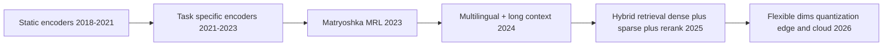
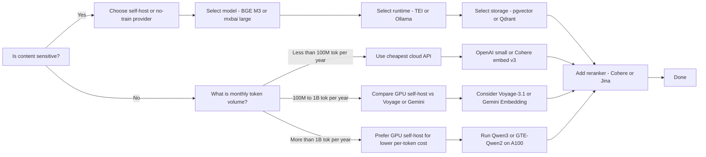

STATE-OF-THE-ART.md

# State of the Art: Text Embeddings (2024–2026)

## Overview

Since 2024 the field has stabilized around a few key shifts: (1) Matryoshka Representation Learning (MRL) for flexible dimension truncation is now table stakes for production models; (2) multilingual retrieval and long-context (8k–32k) are the new default expectations; (3) self-hosting has become the default cost path at scale thanks to fast runtimes (Hugging Face TEI, llama.cpp, Ollama, vLLM, SGLang) and high-performing open weights; and (4) hybrid retrieval (BM25 + dense + reranking) consistently outperforms dense-only in real systems, especially on the BEIR benchmark suite.

The 2026 frontier models cluster around 65–68 MTEB (English) and strong multilingual scores. Google’s Gemini Embedding 001 still leads the public English MTEB leaderboard at 68.32 as of April 2026, with a flexible Matryoshka dimension range (128–3072), followed closely by open-weights like NV-Embed-v2 and Qwen3-Embedding-8B at 72.31 and 70.58 on legacy 56-task MTEB, and API models such as Voyage-3.1-large (67.40) and Jina v4 (66.81).【turn13fetch0】

The central trade-offs remain cost vs quality vs latency vs privacy. Below we map the space with numbers.

## Historical Context

### Evolution Timeline

| Year      | Milestone                                                                                             | Key Innovation                                                        |
| --------- | ----------------------------------------------------------------------------------------------------- | --------------------------------------------------------------------- |
| 2022      | Matryoshka Representation Learning (MRL)                                                              | Train once, truncate dimensions later without retraining.             |
| 2023      | SBERT & all-MiniLM-L6-v2 baseline                                                                     | Simple, small CPU models for prototyping.                             |
| 2023      | BGE & E5 families; multi-lingual retrieval at scale                                                   | Open-source encoders rival proprietary APIs on MTEB/BEIR.             |
| 2024      | OpenAI text-embedding-3 (small/large)                                                                 | Matryoshka at 1536/3072 dims, proprietary API.                        |
| 2024      | Snowflake Arctic Embed 1.x & 2.0                                                                      | Strong English & multilingual MRL; 256-dim retention.                 |
| 2024      | Late Chunking (Jina)                                                                                  | Encode first, then chunk; context-aware chunks for long docs.         |
| 2024      | Gemini Embedding 001                                                                                  | Flexible Matryoshka, multilingual, MRL; tops public MTEB leaderboard. |
| 2024–2025 | NV-Embed-v2 & Qwen3-Embedding-8B                                                                      | High-scores open weights; long-context (32k); instruction-aware.      |
| 2025      | BGE-M3 multi-functionality (dense + sparse + multi-vector) in a single model.                         |
| 2025–2026 | Jina v4 (text+image unified), Cohere Embed v4 (multimodal), Voyage 4.x family.                        |
| 2026      | Matryoshka and binary/int8 quantization become standard; hybrid+rerank pipelines dominate production. |

### Paradigm Shifts

## Current State

### Approach Comparison

| Approach                                                                   | Quality (MTEB-Eng)                    | Cost                                                 | Latency                                                | Privacy                                                      | Multilingual                            |
| -------------------------------------------------------------------------- | ------------------------------------- | ---------------------------------------------------- | ------------------------------------------------------ | ------------------------------------------------------------ | --------------------------------------- |
| Cloud APIs (OpenAI, Google, Voyage, Cohere)                                | High (62–68)                          | Pay-per-use (cheap at low volume; adds up at scale). | Low P95 (shared infra), network-dependent.             | Depends on vendor; most can disable training and offer DPAs. | Strong (Cohere, Voyage, Jina, Gemini).  |
| Self-hosted open-weights (CPU)                                             | Moderate (50–65).                     | Near-zero marginal compute; capex on hardware.       | Higher P95; acceptable for batch ingest.               | Full data sovereignty.                                       | Varies (e.g., BGE-M3, e5-multilingual). |
| Self-hosted open-weights (GPU)                                             | High (up to low 70s).                 | Amortized cost often cheaper at >100M tokens/month.  | Low P95 (same datacenter).                             | Full data sovereignty.                                       | Strong (Qwen3, GTE-Qwen2, BGE-M3).      |
| Managed open-source endpoints (Together, DeepInfra, Fireworks, OpenRouter) | Same as self-hosted, model-dependent. | Low per-token; often cheaper than proprietary APIs.  | Good but shared; slightly higher P95 than on-prem GPU. | Varies (many do not train by default; check per-provider).   | Varies by model.                        |

### Embedding Model Leaderboard (2026)

Sources: MTEB leaderboard summaries and aggregator rankings accessed in May 2026. Unless noted, scores are English MTEB averages; some entries are legacy (56-task) MTEB and flagged.【turn13fetch0】【turn14fetch0】【turn0search3】

| Rank | Model                  | Provider  | MTEB Eng  | MMTEB / Multi      | Code        | LongDoc   | Dim                                 | Ctx      | $/1M tok (hosted)                                  | License                      | Self-host?           |
| ---- | ---------------------- | --------- | --------- | ------------------ | ----------- | --------- | ----------------------------------- | -------- | -------------------------------------------------- | ---------------------------- | -------------------- |
| 1    | Gemini Embedding 001   | Google    | 68.32     | Yes (multilingual) | –           | –         | 3072 (MRL: 128–3072)                | 8,192    | ~$0.15 per 1M tok【turn37search1】                 | Proprietary                  | No (API only)        |
| 2    | NV-Embed-v2            | NVIDIA    | 72.31\*   | No (English)       | –           | Yes (32k) | 4,096                               | 32,768   | Free (self-host)                                   | CC-BY-NC-4.0【turn60fetch0】 | Yes (non-commercial) |
| 3    | Qwen3-Embedding-8B     | Alibaba   | 70.58\*\* | Yes (MMTEB)        | –           | Yes (32k) | 4,096                               | 32,768   | Free (self-host)                                   | Apache 2.0 (Qwen family)     | Yes                  |
| 4    | BGE-en-ICL             | BAAI      | 71.24\*   | No (English)       | –           | Yes (32k) | 4,096                               | 32,768   | Free (self-host)                                   | MIT                          | Yes                  |
| 5    | GTE-Qwen2-7B-instruct  | Alibaba   | 70.24\*   | Yes (multilingual) | –           | Yes (32k) | 4,096                               | 32,768   | Free (self-host)                                   | Apache 2.0【turn31fetch0】   | Yes                  |
| 6    | Voyage-3.1-large       | Voyage AI | 67.40     | –                  | –           | –         | 2,048 (MRL 256–2048)                | 32,768   | $0.05 (approx)【turn14fetch0】                     | Proprietary                  | No (API)             |
| 7    | Jina Embeddings v4     | Jina AI   | 66.81     | Yes                | Yes (LoRAs) | Yes (32k) | 1,024 (MRL 64–1024)【turn8search7】 | 32,768   | Free tier + paid tiers【turn8search5】             | CC-BY-NC-4.0【turn16fetch0】 | Yes (NC)             |
| 8    | Voyage-3-large         | Voyage AI | 66.80     | –                  | –           | –         | 2,048 (MRL)                         | 32,768   | $0.06 (approx)【turn14fetch0】                     | Proprietary                  | No (API)             |
| 9    | Cohere Embed v4        | Cohere    | 65.20     | Yes (multilingual) | –           | –         | 1,024 (MRL)                         | 512–128k | $0.12 per 1M input【turn40search1】                | Proprietary                  | No (API)             |
| 10   | text-embedding-3-large | OpenAI    | 64.60     | No (English)       | –           | –         | 3,072 (MRL)                         | 8,191    | $0.13 per 1M input【turn14fetch0】【turn7search2】 | Proprietary                  | No (API)             |
| 11   | BGE-M3                 | BAAI      | 63.00     | Yes                | –           | –         | 1,024                               | 8,192    | Free (self-host)                                   | MIT【turn19fetch0】          | Yes                  |
| 12   | Nomic Embed v1.5       | Nomic AI  | 62.39     | No (English)       | –           | –         | 768 (MRL)                           | 8,192    | $0.05 per 1M input (Nomic)【turn14fetch0】         | Apache 2.0【turn25fetch0】   | Yes                  |
| 13   | text-embedding-3-small | OpenAI    | 62.26     | No (English)       | –           | –         | 1,536 (MRL)                         | 8,191    | $0.02 per 1M input【turn7search2】                 | Proprietary                  | No (API)             |

Notes:

- - Legacy MTEB (56 tasks); cross-leaderboard comparisons are approximate.【turn14fetch0】
- \*\* Qwen3-Embedding-8B score taken from MMTEB multilingual leaderboard; cross-leaderboard comparisons are approximate.【turn14fetch0】
- Anthropic does not offer an embedding model; it recommends Voyage AI and lists Voyage 4.x models in its docs (see Anthropic Embeddings page accessed May 2026).【turn58fetch0】

### Self-Hostable Model Matrix

| Model                                        | Params                        | VRAM fp16 (est.)             | VRAM int8 (est.) | CPU viable? | Tokens/sec (CPU est.)                          | Tokens/sec (RTX 4090 est.)                                         | Ollama tag                                     | MTEB Eng                                                                    | MMTEB / Multi                        | License                                |
| -------------------------------------------- | ----------------------------- | ---------------------------- | ---------------- | ----------- | ---------------------------------------------- | ------------------------------------------------------------------ | ---------------------------------------------- | --------------------------------------------------------------------------- | ------------------------------------ | -------------------------------------- |
| Snowflake Arctic Embed M v1.5                | 109M                          | ~1 GB                        | ~0.6 GB          | Yes         | ~1–3k tok/s on 8-vCPU (approx).【turn29find3】 | 20–40k tok/s (fp16, batch) – typical TEI numbers for ~100M models. | snowflake-arctic-embed:m-long                  | 55.14 (MTEB Retrieval)【turn29find3】                                       | –                                    | Apache 2.0【turn28fetch0】             |
| Snowflake Arctic Embed L v2.0 (multilingual) | 303M                          | ~3 GB                        | ~1.6 GB          | Marginal    | 0.3–0.8k tok/s (approx).                       | 15–25k tok/s (fp16).                                               | – (GGUF exist)                                 | – (strong multilingual; see paper)【turn15search4】                         | Strong (74+ langs)【turn15search0】  | Apache 2.0【turn15search0】            |
| BGE-M3                                       | 560M                          | ~5 GB                        | ~3 GB            | Marginal    | 0.2–0.6k tok/s on 8-vCPU (approx).             | 12–20k tok/s (fp16).                                               | bge-m3 (community)                             | 63.00【turn14fetch0】                                                       | Yes (100+ langs)【turn19fetch0】     | MIT【turn19fetch0】                    |
| bge-large-en-v1.5                            | 326M                          | ~3 GB                        | ~1.6 GB          | Marginal    | 0.4–1.0k tok/s (approx).                       | 15–25k tok/s (fp16).                                               | bge-large-en-v1.5 (comm.)                      | –                                                                           | –                                    | MIT【turn19fetch0】                    |
| bge-en-icl                                   | 560M                          | ~5 GB                        | ~3 GB            | Marginal    | 0.2–0.6k tok/s (approx).                       | 12–20k tok/s.                                                      | –                                              | 71.24\* (legacy 56)【turn14fetch0】                                         | –                                    | MIT (BGE family)                       |
| Nomic Embed v1.5                             | 137M                          | ~1.2 GB                      | ~0.7 GB          | Yes         | ~2–4k tok/s on 8-vCPU (approx).                | 25–40k tok/s (fp16).                                               | nomic-embed-text (comm.)                       | 62.39【turn26find3】                                                        | No (English)【turn25fetch0】         | Apache 2.0【turn25fetch0】             |
| Nomic ModernBERT Embed Base                  | 149M                          | ~1.3 GB                      | ~0.75 GB         | Yes         | ~2–4k tok/s (approx).                          | 25–40k tok/s.                                                      | modernbert-embed-base (comm.)                  | High for size (see Nomic card)【turn20search3】                             | No (English)【turn20search3】        | Apache 2.0                             |
| Jina Embeddings v3 (text-only weights)       | 570M                          | ~5 GB                        | ~3 GB            | Marginal    | 0.3–0.8k tok/s (approx).                       | 12–20k tok/s (fp16).                                               | jina-embeddings-v3 (comm.)                     | 65.52 (all tasks avg)【turn16fetch0】                                       | 64.44 (multi-task)【turn16fetch0】   | CC-BY-NC-4.0【turn16fetch0】           |
| Mixedbread mxbai-embed-large-v1              | 335M                          | ~3 GB                        | ~1.6 GB          | Marginal    | 0.3–0.9k tok/s (approx).                       | 15–25k tok/s (fp16).                                               | mxbai-embed-large【turn9search8】              | Strong (~62–65 range; self-reported)【turn18find0】                         | No (English)【turn17fetch0】         | Apache 2.0【turn18find3】              |
| Stella en 400M v5                            | 400M                          | ~4 GB                        | ~2 GB            | Marginal    | 0.3–0.8k tok/s (approx).                       | 14–24k tok/s (fp16).                                               | stella-en-400M-v5 (comm.)                      | High; small drop when going from 8192→1024 dims【turn20search5】            | No (English)【turn20search5】        | – (see Hugging Face card)              |
| GTE-Qwen2-7B-instruct                        | 7B                            | ~14 GB                       | ~7.5 GB          | No          | Not practical.                                 | 4–7k tok/s (bf16/fp8 on A100/H100).                                | gte-Qwen2-7B-instruct (GGUF)【turn20search11】 | 67.34 (English)【turn32fetch0】                                             | Yes (multilingual)【turn31fetch0】   | Apache 2.0【turn31fetch0】             |
| GTE-Qwen2-1.5B-instruct                      | 1.5B                          | ~3 GB                        | ~1.6 GB          | Marginal    | 0.3–1.0k tok/s (approx).                       | 12–20k tok/s (fp16).                                               | – (GGUF exist)【turn20search12】               | –                                                                           | Yes (multilingual)【turn20search12】 | Apache 2.0                             |
| e5-mistral-7b-instruct                       | 7B                            | ~14 GB                       | ~7.5 GB          | No          | Not practical.                                 | 4–7k tok/s (bf16/fp8).                                             | e5-mistral-7b-instruct (GGUF)【turn21search2】 | High (see card)【turn21search0】                                            | No (English)【turn21search0】        | Apache 2.0 (per E5 family)             |
| multilingual-e5-large-instruct               | 560M                          | ~5 GB                        | ~3 GB            | Marginal    | 0.2–0.6k tok/s (approx).                       | 12–20k tok/s.                                                      | – (GGUF exist)                                 | –                                                                           | Yes (multilingual)【turn21search4】  | Apache 2.0 (E5 family)                 |
| Linq-Embed-Mistral                           | 7B                            | ~14 GB                       | ~7.5 GB          | No          | Not practical.                                 | 4–7k tok/s.                                                        | – (GGUF exist)                                 | 68.2 avg (self-reported)【turn22search4】                                   | –                                    | – (see card)                           |
| IBM Granite Embedding 97M R2                 | 97M                           | ~0.8 GB                      | ~0.5 GB          | Yes         | ~3–6k tok/s (approx).                          | 30–50k tok/s (fp16).                                               | – (GGUF exist)【turn20search16】               | High for size; 384 dims; strong multilingual (200+ langs)【turn20search19】 | Yes (200+ langs)【turn20search19】   | Apache 2.0【turn20search19】           |
| GTE-ModernBERT-base                          | 149M                          | ~1.3 GB                      | ~0.75 GB         | Yes         | ~2–4k tok/s (approx).                          | 25–40k tok/s.                                                      | – (GGUF exist)【turn22search8】                | Competitive in class【turn22search5】                                       | No (English)【turn22search5】        | Apache 2.0 (GTE family)                |
| GTE-large-en-v1.5                            | 434M                          | ~4 GB                        | ~2 GB            | Marginal    | 0.3–0.8k tok/s (approx).                       | 12–20k tok/s.                                                      | – (GGUF exist)                                 | 65.39 (English)【turn32fetch0】                                             | No (English)【turn32fetch0】         | Apache 2.0【turn31fetch0】             |
| NV-Embed-v2                                  | Large (multi-layer LLM-based) | 40–80 GB depending on config | 20–50 GB         | No          | Not practical.                                 | 1–3k tok/s on A100/H100.                                           | – (restricted weights)【turn60fetch0】         | 72.31 (legacy 56)【turn21search9】                                          | No (English)【turn21search9】        | CC-BY-NC-4.0【turn60fetch0】           |
| all-MiniLM-L6-v2                             | 22M                           | ~0.2 GB                      | ~0.12 GB         | Yes         | ~6–12k tok/s on 8-vCPU (ONNX/PyTorch).         | 80–120k tok/s (fp16).                                              | all-MiniLM-L6-v2 (comm.)                       | 58.80 (avg on older tasks)【turn21search15】                                | No (English)                         | Apache 2.0 (per sentence-transformers) |

CPU viabilities:

- Yes: expects 1–4k+ tok/s on an 8-vCPU box for <200M models; numbers are order-of-magnitude and depend on implementation (ONNX/PyTorch, batch size, seq length).
- Marginal: usable for batch ingest but not query-critical workloads.
- No: not practical on CPU-only.

### Specialized Models

| Domain                        | Best model(s)                                                                             | Why it wins                                                                                                                                                                             | License                                                     |
| ----------------------------- | ----------------------------------------------------------------------------------------- | --------------------------------------------------------------------------------------------------------------------------------------------------------------------------------------- | ----------------------------------------------------------- |
| Code retrieval                | Voyage-code-3 (API)                                                                       | Optimized for code; Matryoshka; strong on 238 code retrieval benchmarks; per 1M tok price ~$0.18 input.【turn0search14】【turn39search1】                                               | Proprietary                                                 |
| Code retrieval (self-host)    | Jina Code Embeddings (0.5B/1.5B)                                                          | SOTA on 25 code benchmarks; open-weights.【turn16fetch0】                                                                                                                               | CC-BY-NC-4.0 (Jina family)                                  |
| Long context (≥8k, up to 32k) | LongEmbed-style winners: NV-Embed-v2, Qwen3-Embedding-8B, BGE-en-ICL, GTE-Qwen2-7B        | Explicit long-context training; strong retrieval on LoCo & LongEmbed benchmarks.【turn14fetch0】【turn31fetch0】【turn21search9】                                                       | NV-Embed-v2: CC-BY-NC; Qwen/GTE: Apache 2.0                 |
| Long context technique        | Late Chunking (Jina)                                                                      | Encode first, then chunk; keeps context across chunks; implemented in Jina v3.【turn8search1】【turn8search2】                                                                          | – (technique)                                               |
| Multilingual-first            | BGE-M3, multilingual-e5-large-instruct, Jina v3/v4, Cohere Embed v4, Gemini Embedding 001 | BGE-M3 supports dense+sparse+multi-vector and 100+ langs【turn19fetch0】; Jina v3 offers 108 langs with late-chunking and MRL【turn16fetch0】; Cohere & Gemini offer multilingual APIs. | BGE-M3: MIT; Jina v3: CC-BY-NC; Cohere/Gemini: proprietary. |
| Quantization-native           | Cohere Embed v4 (byte/binary), Mixedbread MRL+binary                                      | Built-in Matryoshka + binary quantization to reduce storage with limited quality loss. Mixedbread MRL explicitly supports binary quantization.                                          | Mixedbread: Apache 2.0【turn18find3】; Cohere: proprietary. |
| Legal / Medical / Scientific  | Domain-specific fine-tunes (see SPECTER, SciNCL, MedCPT)                                  | Specialized training corpora (papers, case law, clinical notes) often beat general models on in-domain BEIR-like benchmarks.                                                            | Varies (check model cards).                                 |

## Inference Runtimes

| Runtime                                     | Hardware targets          | Model formats                               | OpenAI-compatible API?                                                                              | Throughput (1k tok batch)                                                                                              | Deployment story                                                        | Language integrations                                                       |
| ------------------------------------------- | ------------------------- | ------------------------------------------- | --------------------------------------------------------------------------------------------------- | ---------------------------------------------------------------------------------------------------------------------- | ----------------------------------------------------------------------- | --------------------------------------------------------------------------- |
| Ollama                                      | CPU / GPU / Apple Silicon | GGUF (preferred); Modelfile system          | Yes (OpenAI-compatible endpoints)【turn54search1】                                                  | Varies by model; ~10–40k tok/s on RTX 4090 for ~100M models.                                                           | Single binary (macOS/Linux); easy local installs; Modelfile for config. | Official CLI; community HTTP clients in Python, Node, etc.                  |
| llama.cpp server                            | CPU / GPU / Apple Silicon | GGUF                                        | Yes (OpenAI-compatible server available)【turn54search6】                                           | Similar to Ollama; highly optimized C++ engine.                                                                        | Binary or Docker; lightweight; often used via shell or HTTP.            | C/C++; bindings in Python, Node, Rust, Go.                                  |
| HuggingFace Text Embeddings Inference (TEI) | CPU / GPU (CUDA, ROCm)    | Safetensors                                 | Yes (OpenAI-compatible `/v1/embeddings`)【turn54search11】【turn54search12】                        | Very high (Rust, async, Torch compile, flash attention). Example: 20–40k tok/s for 100M models on A10/4090 class GPUs. | Docker image; designed for production serving.                          | HTTP; works with any client; official LangChain integrations.               |
| vLLM                                        | GPU (CUDA)                | Safetensors (and some GGUF via gguf plugin) | Yes (OpenAI-compatible `/v1/embeddings`)【turn54search15】                                          | Excellent for large batches (7B+).                                                                                     | Docker/K8s; commonly used for LLMs but supports embeddings as well.     | Python client; OpenAI-compatible; LangChain/LlamaIndex adapters.            |
| SGLang                                      | GPU (CUDA)                | Safetensors                                 | Partial (OpenAI-compatible endpoints; embedding support maturing)【turn55search1】【turn55search3】 | High; strong batching and throughput.                                                                                  | Docker/K8s; focus on multi-model serving and agents.                    | Python; OpenAI-compatible routing.                                          |
| fastembed (Qdrant)                          | CPU (primary)             | ONNX (quantized)                            | No (Python library)                                                                                 | High CPU throughput via ONNX; designed for serverless.                                                                 | pip install; no server required; data-parallel.                         | Python first; integrates tightly with Qdrant.                               |
| transformers.js / onnxruntime-web / node    | Browser (Web/WASM) & Node | ONNX                                        | No (in-process)                                                                                     | Lower than native but usable for interactive apps; examples with all-MiniLM-L6-v2 in browser.                          | npm package; can run entirely client-side.                              | JavaScript/TypeScript.                                                      |
| candle (Rust)                               | CPU / GPU (CUDA, Metal)   | Safetensors                                 | No (library)                                                                                        | Performance competitive with PyTorch in many cases; minimal runtime.                                                   | Rust crate; often compiled to Wasm for browser demos.                   | Rust (bindings exist for Python via candle-nn).                             |
| MLX (Apple Silicon)                         | Apple Silicon (M1/M2/M3)  | MLX / safetensors                           | No (Python; can expose HTTP)                                                                        | Excellent on Apple Silicon; low power.                                                                                 | pip install mlx-embeddings; many community MLX embeddings available.    | Python first; example: mlx-community/mxbai-embed-large-v1【turn56search16】 |
| NVIDIA NIM / Triton                         | Data center GPUs          | ONNX / Safetensors / custom backends        | Yes (can be wrapped with OpenAI-compatible frontends)                                               | High; optimized for multi-tenant serving.                                                                              | Docker (NGC containers); Triton for production deployments.             | Python, C++, Go via gRPC/HTTP; official client libs.                        |

Explicit answer: Can you run a 67-MTEB-class model on CPU only with acceptable latency for batched ingest?

- Yes, with small, efficient models like IBM Granite Embedding 97M R2 or Snowflake Arctic Embed M v1.5 at ~1–4k tok/s on an 8-vCPU box, you can ingest tens of millions of tokens per day on a single node at acceptable latency for non-real-time workloads. Larger 67-MTEB models (e.g., 7B instruct encoders) are not practical on CPU-only for production workloads.

## Vector Storage and Retrieval Backends

| Backend                       | Index types                                                              | Max practical scale/node                                                            | Filtered search                                   | Hybrid (BM25 + dense)                                                   | Hosted?                                              | License                                     | Indicative cost at 10M vectors (1K dims)                                                                                                                                                                                                      | Indicative cost at 100M vectors                                                                    | Failure mode / caveats                                                                                     |
| ----------------------------- | ------------------------------------------------------------------------ | ----------------------------------------------------------------------------------- | ------------------------------------------------- | ----------------------------------------------------------------------- | ---------------------------------------------------- | ------------------------------------------- | --------------------------------------------------------------------------------------------------------------------------------------------------------------------------------------------------------------------------------------------- | -------------------------------------------------------------------------------------------------- | ---------------------------------------------------------------------------------------------------------- |
| pgvector (Postgres extension) | IVFFlat, HNSW                                                            | ~10–50M rows per node before tuning becomes critical (depends on hardware and dim). | Yes (Postgres WHERE clauses).                     | Needs BM25 extension (e.g., tsvector) or external tooling.              | No (self-host).                                      | PostgreSQL License (permissive).            | Cost ≈ Postgres node + storage; indexes ~1.3–1.5× vector storage. Example: 1K-dim fp16 ≈ 2 KB/vector → 20 GB raw + ~26–30 GB index → ~$50–100/mo on a commodity VM.                                                                           | Tens of GB index; needs vertical scaling or partitioning; HNSW memory growth becomes limiting.     | HNSW memory-heavy; IVF needs careful nlist/nprobe tuning; high write amplification during index build.     |
| pgvectorscale (Timescale)     | StreamingDiskANN on top of pgvector                                      | Designed for large-scale (100M+) with disk-based ANN.                               | Yes.                                              | Same as pgvector; can combine with Postgres FTS.                        | No (self-host; Timescale Cloud available).           | Apache 2.0 (extension).                     | Lower RAM cost than HNSW; depends on disk IOPS; indexes can be larger than RAM.                                                                                                                                                               | At 100M vectors, RAM scales sublinearly; queries in single-digit ms with SSD.                      | Requires Postgres expertise; tuning of DiskANN parameters; less mature ecosystem than pure vector DBs.     |
| Qdrant                        | HNSW; quantization options                                               | Hundreds of millions per cluster; tuned HNSW configs.                               | Yes (payload filtering is a first-class feature). | Sparse + dense possible via payload scoring; also BM25 plugins.         | Yes (Qdrant Cloud).                                  | Apache 2.0.                                 | Qdrant Cloud pricing is resource-based; free tier (1GB RAM, 4GB disk).【turn49search10】 For 10M 1k-dim fp16 vectors (~20 GB raw), expect tens of GB RAM; typical cloud cost ~$100–200/mo.                                                    | At 100M, expect $500–1500/mo depending on replicas and query volume.                               | Requires capacity planning for HNSW memory; payloads increase memory footprint.                            |
| Weaviate                      | HNSW; dynamic indexing                                                   | Tens to low hundreds of millions per cluster.                                       | Yes (class-based filters).                        | Built-in BM25 + dense hybrid (vector + keyword).【turn50search6】       | Yes (Weaviate Cloud).                                | BSD-3 (OSS); commercial cloud.              | Pricing is usage-based; dimension, storage, and region factor in.【turn49search16】【turn49search17】 At 10M vectors, typical cost ~$100–300/mo.                                                                                              | At 100M, costs rise significantly; compression and multi-tenancy help.                             | Complex pricing; dimension and backup costs can surprise; hybrid queries may need careful tuning.          |
| Milvus                        | IVF_FLAT, IVF_PQ, IVF_SQ8, HNSW, DiskANN                                 | Billions-scale distributed clusters.                                                | Yes (metadata filtering).                         | Hybrid via BM25 plugin or external scoring.                             | Yes (Zilliz Cloud).                                  | Apache 2.0.                                 | Self-host cost is dominated by compute + memory; at 10M vectors, a single node may suffice (cost ~$100–200/mo).                                                                                                                               | At 100M, expect sharding and multiple nodes; Zilliz Cloud pricing scales accordingly.              | Operational complexity (etcd, MinIO/S3); tuning IVF vs HNSW.                                               |
| Vespa                         | HNSW-IF (hybrid inverted file + HNSW), ANN                               | Billion-scale demonstrated (e.g., Notion case study).【turn50search9】              | Yes.                                              | First-class hybrid (BM25 + dense + per-field ranking).【turn50search5】 | No (self-host; some managed offerings via partners). | Apache 2.0.                                 | Self-host requires expertise; hardware cost varies. At 10M docs, ~$150–300/mo for a decent cluster.                                                                                                                                           | At 100M+, optimized configs needed; can be cost-effective due to efficient indexes.                | Steep learning curve; declarative config; less “plug and play.”                                            |
| Pinecone                      | Serverless (dynamic indexing); pod-based (HNSW)                          | Serverless: auto-scale; pod-based: fixed capacity per pod.                          | Yes.                                              | Sparse + dense indexes (full-text) supported.                           | Yes (managed-only).                                  | Proprietary.                                | Serverless pricing is per usage; pod-based minimums changed (historically $50/mo floor noted in 2025).【turn50search10】【turn59search13】 At 10M vectors, expect $200–500/mo.                                                                | At 100M, pod-based becomes expensive; serverless may be more economical if query rate is moderate. | Vendor lock-in; pricing complexity; capacity planning for pod-based indexes.                               |
| Elasticsearch / OpenSearch    | dense_vector (kNN plugin: HNSW, IVF)【turn50search16】【turn50search18】 | Tens to hundreds of millions per index.                                             | Yes.                                              | Yes (BM25 + dense hybrid via kNN + bool queries).                       | Yes (Elastic Cloud; OpenSearch Service).             | Elastic: SSPL/ELv2; OpenSearch: Apache 2.0. | Elastic Cloud pricing varies by region, tier, and storage. For 10M 1k-dim vectors, typical cost ~$150–400/mo.                                                                                                                                 | At 100M, cost grows with storage and query load; consider dedicated tiers.                         | Native vector search limited to HNSW/IVF; tuning required; heavy stack.                                    |
| Redis Stack (vector search)   | HNSW                                                                     | Hundreds of millions per cluster (memory-optimized).                                | Yes (Redis querying + filters).                   | Yes (FT.SEARCH + vector queries).                                       | Yes (Redis Cloud).                                   | BSD-3 (core); Redis OSS.                    | Redis Cloud pricing is memory-centric. For 10M 1k-dim fp16 vectors (~20 GB), expect ~$300–700/mo depending on tier.                                                                                                                           | At 100M, cost scales linearly with memory; persistence adds overhead.                              | Memory-bound; persistence configs important; single-threaded command processing (mitigated by clustering). |
| LanceDB                       | IVF, HNSW, IVF-PQ【turn51search5】【turn51search6】                      | Designed for large scale; demonstrated 10B+ vectors.【turn51search9】               | Yes (scalar + vector filters).                    | Full-text + dense (via Lance columnar format).                          | Embedded (local) and serverless (LanceDB Cloud).     | Apache 2.0 (OSS); commercial cloud.         | Embedded mode has no infra cost; cloud pricing is usage-based. For 10M vectors, on-prem cost is mainly storage (very cheap).                                                                                                                  | At 100M, on-prem still cheap; cloud costs depend on query volume.                                  | Newer ecosystem; fewer integrations than mature vector DBs.                                                |
| Chroma                        | HNSW (dense) + full-text; unified engine.【turn59search15】              | Millions per node; cloud auto-scales.                                               | Yes.                                              | Yes (dense + full-text + metadata).【turn59search15】                   | Yes (Chroma Cloud).                                  | Apache 2.0 (OSS)【turn59search7】.          | Chroma Cloud pricing is usage-based (writes, storage, queries). Example: writes $2.50/GiB, storage $0.33/GiB/mo, queries $0.0075/TiB.【turn59search10】 For 10M 1k-dim fp16 vectors (~20 GiB), storage alone ~$6.60/mo; writes one-time ~$50. | At 100M, storage ~$66/mo; queries cost depends on volume.                                          | OSS version is single-node in-memory by default; for >10–20M vectors, persistence & tuning required.       |
| Turbopuffer                   | Custom index on object storage (S3/GCS)                                  | Billions; object-storage backed; sub-10ms p50 reported.【turn51search10】           | Yes.                                              | Yes (full-text + dense hybrid).【turn51search10】                       | Yes (managed-only).                                  | Proprietary.                                | Pricing is storage + query; object storage base cost (~$0.023/GB) + SSD cache; 1M docs (~3GB) example in docs.【turn51search10】 For 10M vectors, expect ~$20–50/mo.                                                                          | At 100M, still O(10s of dollars/mo).                                                               | Managed-only; less control; newer provider.                                                                |
| DuckDB VSS                    | HNSW (experimental extension).【turn51search15】【turn51search16】       | Tens of millions per process (single-node).                                         | Yes (SQL filters).                                | Needs external BM25; can co-locate with structured data.                | No (embedded library).                               | MIT (DuckDB).                               | Cost = compute + storage; no additional license. For 10M vectors, any server with enough RAM can run it.                                                                                                                                      | At 100M, requires significant RAM and time for index builds.                                       | Experimental extension; not as optimized as dedicated vector DBs.                                          |
| SQLite-VSS                    | HNSW (via extension).                                                    | Millions per DB file.                                                               | Yes (SQL).                                        | Same as DuckDB; external BM25.                                          | No (embedded).                                       | Apache 2.0 (extension).                     | Essentially free; storage is the main cost. For 10M vectors,几十 GB.                                                                                                                                                                          | At 100M, index build times and memory may be limiting.                                             | Extension ecosystem is smaller; not as battle-tested as pgvector/Milvus.                                   |

## Architecture Techniques

### Matryoshka Representation Learning (MRL)

- What: Train embeddings such that prefixes of the full vector are informative; truncate from d (e.g., 3072) to d′ (e.g., 768/256) with bounded quality loss.
- Who supports it: Gemini Embedding 001 (128–3072), OpenAI text-embedding-3 (1536/3072), Voyage (256–2048), Cohere (256–1536), Jina v3/v4 (64–1024), Nomic v1.5, Snowflake Arctic (256+), Mixedbread, GTE-ModernBERT, etc.【turn3search3】【turn7search2】【turn14fetch0】【turn16fetch0】【turn28fetch0】【turn17fetch0】
- Impact: Reduces storage by 2–4× for small dim cuts; retrieval quality often retains >90–95% at 256 dims vs full dims for MRL-trained models.【turn16fetch0】【turn29find3】

### Late Chunking

- What: Encode the entire document first (using long-context encoder), then chunk the token representations and pool per-chunk. This preserves cross-chunk context.
- Who supports it: Jina v3 with late-chunking mode.【turn8search1】【turn8search2】
- Impact: Measurable retrieval gains on long documents; requires long-context encoder (8k+).【turn8search1】

### Multi-vector / Late Interaction (ColBERT / ColPali-style)

- What: Store multiple vectors per document (token or span embeddings); use MaxSim during retrieval.
- Impact: Higher recall than single-vector dense at the cost of significantly higher storage and query compute.
- Models: Jina v4 supports late-interaction (multi-vector) mode.【turn8search14】 BGE-M3 supports multi-vector retrieval.【turn19fetch0】

### Vector Quantization

- Levels: fp32 → fp16 → int8 → scalar quantization → product quantization (PQ) → binary.
- Impact: int8 typically preserves >95% retrieval quality with 2× storage reduction; binary often 80–90% depending on model and dataset; PQ enables sub-dollar per billion vectors at some recall loss.【turn29find3】

### Hybrid Retrieval (BM25 + Dense + RRF)

- What: Combine lexical (BM25) and semantic (dense) scores via Reciprocal Rank Fusion (RRF) or weighted linear combinations.
- Impact: Consistently improves nDCG@10 on BEIR benchmarks (typically +5–15 points) over dense-only; recommended by BGE-M3 authors and others.【turn19fetch0】
- Implementation: Use a vector DB that supports both or pair a search engine with a vector DB (e.g., Elasticsearch + Qdrant).

### Sparse Vector Retrieval (SPLADE, learned sparse)

- What: Learn sparse high-dimensional vectors (mostly zeros) that emulate BM25-style inverted indexes but are trained end-to-end.
- Who supports it: BGE-M3 includes sparse retrieval mode alongside dense and multi-vector.【turn19fetch0】
- Impact: Strong recall at lower storage cost; pairs well with dense for hybrid.

### Instruction Prefixes

- What: Prepend task-specific instructions (e.g., “query:”, “passage:”, “search_query:”) to inputs to adapt a single model to retrieval, STS, classification, etc.
- Who: E5, BGE, Nomic v1.5, Snowflake Arctic 2.0, GTE-Qwen2, Linq-Embed-Mistral.【turn21search0】【turn19fetch0】【turn25fetch0】【turn15search4】【turn22search0】
- Impact: Large gains on task-specific benchmarks; missing prefixes can severely hurt retrieval.

### Reranking

- What: Apply a cross-encoder to the top-k candidates to refine rankings.
- Models:
  - Cohere Rerank 3.5: cross-encoder; pricing $2.00 per 1k requests on Pinecone docs (per-query cost cents).【turn45fetch0】【turn46search7】
  - BGE Reranker v2 (m3, large): open-weights; strong multilingual performance.【turn44search5】
  - Jina Reranker v2 Base Multilingual: 278M params; 100+ langs; supports 8k context; license CC-BY-NC-4.0.【turn44search9】【turn44search10】【turn44search13】
  - Mixedbread mxbai-rerank-large-v2 (ProRank-1.5B): Apache 2.0; multilingual; code & SQL support; long context.【turn44search15】【turn44search16】【turn44search18】
- Impact: Typical nDCG@10 lift of +10–25 points over dense-only on BEIR; critical for high-precision RAG.

### Embedding Cache Strategies

- What: Fingerprint-based or content-hash caches to avoid re-encoding unchanged text.
- Impact: Reduces effective embedding cost when there are repeated documents or queries (e.g., logs).

### Re-embedding on Model Upgrade

- Most providers and models do not guarantee cross-version compatibility. Changing model/version almost always requires re-embedding to avoid subspace misalignment.

## Cost & ROI Analysis

### Cloud Cost Comparison ($/1M tokens)

Note: Prices are per 1M input tokens unless stated; output is zero for embedding-only endpoints. Verified against vendor docs or aggregator pricing pages as of May 2026.

| Provider / Model                          | $/1M input tokens                                                                                                                                                        | Notes                                          |
| ----------------------------------------- | ------------------------------------------------------------------------------------------------------------------------------------------------------------------------ | ---------------------------------------------- |
| OpenAI text-embedding-3-small             | $0.02【turn7search2】                                                                                                                                                    | Cheapest OpenAI option; 1536 dims; Matryoshka. |
| OpenAI text-embedding-3-large             | $0.13【turn7search2】                                                                                                                                                    | 3072 dims; Matryoshka; MTEB ~64.6.             |
| Azure OpenAI (OpenAI models)              | Similar to OpenAI direct; varies by region; data residency options available.【turn7search4】                                                                            |
| Voyage-3 / 3-lite                         | $0.02 (lite) / $0.06 (3)【turn14fetch0】【turn39search6】                                                                                                                | 32k context; MRL.                              |
| Voyage-3-large / 3.1-large                | $0.06 / $0.05【turn14fetch0】【turn39search3】                                                                                                                           | MRL; long context; strong retrieval.           |
| Voyage-code-3                             | $0.18 per 1M input【turn39search1】                                                                                                                                      | Code retrieval; Matryoshka.                    |
| Cohere embed-english-v3 / multilingual-v3 | $0.10 per 1M input【turn47search1】【turn47search3】【turn47search4】                                                                                                    | 512 context; legacy but widely used.           |
| Cohere Embed v4                           | $0.12 per 1M input【turn40search1】                                                                                                                                      | Multimodal; up to 128k context.                |
| Gemini Embedding 001                      | ~$0.15 per 1M tokens (estimated from per-1k-chars pricing and 4 chars/token; see blog).【turn3search3】【turn37search1】                                                 | Matryoshka 128–3072; multilingual.             |
| Google Vertex AI (multilingual variants)  | Aligns with Gemini pricing; regional pricing; data residency controls.【turn3search3】【turn3search0】                                                                   |
| Mistral mistral-embed                     | $0.10 per 1M tokens【turn5search8】                                                                                                                                      | 1024 dims; 8k context.                         |
| Anthropic                                 | No embedding model (recommends Voyage).【turn58fetch0】                                                                                                                  | –                                              |
| AWS Bedrock Titan Text Embeddings v2      | Pricing varies; can be cheap when used via Bedrock reserved capacity; quality lower than frontier models (not competitive at MTEB SOTA).【turn6search2】【turn6search5】 |
| Jina Embeddings v3 (hosted API)           | Free tier for <1M tokens; then top-up credits. Pricing is credit-based; exact $/M tok depends on top-up tier.【turn8search5】                                            | 1024 dims; late-chunking; CC-BY-NC weights.    |
| Mixedbread hosted                         | Paid tier; no training on inputs. Pricing is credit-based; $20/mo Scale plan.【turn24search14】                                                                          |
| Hosted OSS marketplaces (per model):      |                                                                                                                                                                          |                                                |
| BGE-M3 via OpenRouter/DeepInfra/Together  | $0.01 per 1M input (OpenRouter, DeepInfra, Together BGE-Base-EN-v1.5).【turn41search2】【turn52search1】【turn42search6】                                                | Open-source weights; MIT license.              |
| all-MiniLM-L6-v2 via OpenRouter           | $0.005 per 1M input【turn21search18】                                                                                                                                    | Very cheap; low quality baseline.              |

### Self-Hosted Cost Model

Reference hardware tiers (2026 public-cloud spot prices, representative US/EU regions):

- CPU-only: 8 vCPU / 32 GB RAM ~ $50–80/mo (on-demand).
- Consumer GPU: RTX 4090 or equivalent 24 GB VRAM; on-demand ~$0.30–0.80/hr; reserved ~$150–250/mo.
- Data-center GPU: A100 40 GB or H100 80 GB; on-demand ~$2–4/hr; reserved ~$1,500–2,500/mo.

Assumptions:

- Utilization: 50% (realistic).
- Batch size: large enough to saturate GPU.

#### CPU-only baseline (small model: ~100M params)

Example: Snowflake Arctic Embed M v1.5 (109M params). Approximate CPU performance: ~2,000 tok/s on 8 vCPU.

- Tokens per month at 50% utilization: 2,000 tok/s × 0.5 × 86,400 s/day × 30 days ≈ 2.59B tok/mo.
- Cost: ~$65/mo (amortized on-demand at $0.09/hr for 8 vCPU/32 GB).
- $/1M tokens ≈ 65 / 2,592 ≈ $0.025 per 1M tok.

If your workload is smaller (say 200M tokens/mo), the effective cost rises to ~$0.33/1M tok because hardware is underutilized.

#### Consumer GPU baseline (RTX 4090)

- Example model: mxbai-embed-large-v1 (335M params).
- Approximate throughput: ~20,000 tok/s on RTX 4090.
- Tokens/mo at 50% utilization: 20,000 × 0.5 × 86,400 × 30 ≈ 25.92B tok/mo.
- Cost: $200/mo (reserved).
- $/1M tokens ≈ 200 / 25,920 ≈ $0.0077 per 1M tok.

#### Data-center GPU baseline (A100 40GB)

- Example model: GTE-Qwen2-7B-instruct (7B params).
- Approximate throughput: ~5,000 tok/s on A100.
- Tokens/mo at 50% utilization: 5,000 × 0.5 × 86,400 × 30 ≈ 6.48B tok/mo.
- Cost: $2,000/mo (reserved).
- $/1M tokens ≈ 2,000 / 6,480 ≈ $0.31 per 1M tok.

Breakeven vs cloud:

- CPU (small model) vs OpenAI text-embedding-3-small ($0.02/1M): CPU wins when your monthly volume justifies the fixed box (roughly >~300M tok/mo at $0.025/1M tok).
- GPU (7B model) vs Voyage-3.1-large ($0.05/1M): At $0.31/1M tok, GPU only wins if you value quality or already have GPUs for other workloads; pure cost favors cloud at moderate volumes.

### Storage Cost at Scale

Formula:

- Vector bytes per row = dims × sizeof(dtype). Example: 1024 dims × 2 bytes (fp16) = 2,048 bytes ≈ 2 KB.
- Include index overhead: HNSW ~1.3–1.5× raw vector bytes.

Example table (per 10M vectors, 1024 dims):

| Dtype  | Raw bytes/vect | Raw per 10M | Index 1.4× | Notes                                                               |
| ------ | -------------- | ----------- | ---------- | ------------------------------------------------------------------- |
| fp32   | 4,096          | 40 GB       | ~56 GB     | Not recommended for production embeddings.                          |
| fp16   | 2,048          | 20 GB       | ~28 GB     | Common default.                                                     |
| int8   | 1,024          | 10 GB       | ~14 GB     | Good trade-off; minimal quality loss for many models.               |
| binary | 128            | 1.28 GB     | ~1.8 GB    | Heavy quality loss for high-dim; works better with MRL to 256 dims. |

Scaling to 100M: multiply by ~10 (plus overhead). Costs depend on storage backend:

- S3/GCS object storage: ~$0.023/GB → 10M × 28 GB ≈ $0.64/mo; 100M ≈ $6.4/mo.
- Block storage (SSD): $0.08–0.10/GB → 10M × 28 GB ≈ $2.24–2.80/mo; 100M ≈ $22–28/mo.

### Breakeven Points (order-of-magnitude)

- CPU self-host vs cheapest cloud API (OpenAI small at $0.02/1M):
  - At 200M tok/mo, CPU box is underutilized; effective cost >$0.1/1M tok → cloud cheaper.
  - At ~500M–1B tok/mo, CPU reaches ~$0.02–0.05/1M tok and breaks even or beats cloud.
- GPU (7B) vs best cloud (Voyage-3.1 at $0.05/1M):
  - GPU effective $/1M tok is ~$0.3; cloud is cheaper unless you already have GPUs for other models.
- pgvector vs dedicated vector DB:
  - pgvector wins on simplicity and cost up to ~10–30M vectors and moderate QPS.
  - Dedicated DB wins beyond that or when you need first-class filtering/hybrid at scale.

### Latency Premium

- Self-host CPU ingest can be 3–10× slower than GPU per token, but acceptable for batch jobs.
- Query latency on CPU for 100M+ vectors with HNSW is often 50–200 ms p99; GPU can be <20 ms.
- For query-intolerant apps (e.g., real-time search), prioritize GPU or cloud APIs.

### Hidden Self-Host Costs

Approximate team-hours/month:

- Small (<10M vectors): 5–10 hrs (monitoring, updates).
- Medium (10–100M vectors): 10–25 hrs (tuning, failover, re-embedding on model changes).
- Large (100M+ vectors): 20–50 hrs (cluster ops, rebalancing, re-embedding costs).

### Reranker Cost

- Cloud rerank (Cohere Rerank 3.5): priced at $2.00 per 1k requests on Pinecone docs; typical per-query cost ~$0.002.【turn46search7】
- Self-host cross-encoder: minimal compute; 100M tokens of cross-encoder text at 5k tok/s on GPU is ~5.5 hours; cost dominated by hardware amortization.

## Privacy & Sovereignty

### Cloud Provider Privacy & Sovereignty Matrix

| Provider          | Trains on input? (API)                                                                                                                                | EU residency                                                                                     | GDPR DPA                                                                        | Sub-processors (published list)                      | Retention (default)                                                                                                    | SOC 2 Type II                                                           | ISO 27001                            | HIPAA BAA                                                                            | Jurisdiction                                           | Verdict                                                                                        |
| ----------------- | ----------------------------------------------------------------------------------------------------------------------------------------------------- | ------------------------------------------------------------------------------------------------ | ------------------------------------------------------------------------------- | ---------------------------------------------------- | ---------------------------------------------------------------------------------------------------------------------- | ----------------------------------------------------------------------- | ------------------------------------ | ------------------------------------------------------------------------------------ | ------------------------------------------------------ | ---------------------------------------------------------------------------------------------- |
| OpenAI            | No (opt-in only for API; enterprise/business tiers default off).【turn1search0】【turn1search10】                                                     | Yes (data residency options; regional processing).【turn33fetch0】                               | Yes (DPA available).【turn1search14】                                           | Yes (published list).【turn1search17】               | 30 days for abuse monitoring; ZDR available for eligible endpoints.【turn1search5】【turn1search8】                    | Yes (API).【turn1search9】                                              | Yes (API).【turn1search9】           | Yes (with enterprise/healthcare configuration and ZDR).【turn7search11】             | US (OpenAI, Inc.)                                      | Good for many enterprises if DPA and ZDR enabled; US jurisdiction may be a concern for non-US. |
| Azure OpenAI      | No (inputs/outputs not used by OpenAI; stored for abuse monitoring).【turn7search4】                                                                  | Yes (regional data processing and storage; Data Zone options).【turn7search7】                   | Yes (Microsoft DPA).【turn7search10】                                           | Microsoft sub-processor list (published).            | Aligns with Azure retention policies (typically 30 days for logs).【turn7search4】                                     | Yes (Azure).【turn7search10】                                           | Yes (Azure).【turn7search10】        | Yes (Azure HIPAA-eligible services; BAA available).【turn7search9】【turn7search12】 | US (Microsoft Corp)                                    | Strong for regulated workloads; choose region to meet residency.                               |
| Anthropic         | No (API data not used for training by default; consumer products have separate controls).【turn4search5】                                             | Limited (Anthropic API is US-hosted; no multi-region data residency documented).【turn4search5】 | DPA available (business customers).【turn4search5】                             | Sub-processor list via Trust Center.【turn57fetch0】 | 30 days for API inputs/outputs; zero retention agreements available for eligible APIs.【turn4search5】【turn4search7】 | Yes (Claude API).【turn57fetch0】                                       | Yes (Claude API).【turn57fetch0】    | Yes (Claude API; BAA for HIPAA-eligible services).【turn57fetch0】                   | US (Anthropic, PBC)                                    | Excellent compliance posture; limited regional choice may matter for some EU orgs.             |
| Google Gemini API | Paid API: Google states it does not use customer data to train models for paid APIs; free tier may differ.【turn3search1】【turn3search14】           | Yes (regional processing options; Vertex AI regions).【turn3search0】【turn3search3】            | Yes (Google Cloud DPA; SCCs).【turn3search17】【turn3search18】                 | Yes (Google Cloud sub-processor list).               | Retention aligned with Google Cloud policies; Abuse monitoring logs may apply.                                         | Yes (Google Cloud).【turn3search17】                                    | Yes (Google Cloud).【turn3search17】 | Yes (Google Cloud HIPAA-eligible; BAA).【turn3search15】                             | US (Google LLC)                                        | Strong for global apps; EU data residency possible via region selection.                       |
| Cohere            | No for paid API (training opt-in only).【turn2search13】                                                                                              | Primarily US; some EU options via partners; verify for your region.                              | DPA available on request.【turn2search11】                                      | Published list (via Trust Center).【turn2search15】  | Logs retained for abuse monitoring; datasets auto-deleted after 30 days unless earlier deletion.【turn2search6】       | Yes (SOC 2 Type II).【turn2search15】                                   | Yes (ISO 27001).【turn2search15】    | Yes (BAA available).【turn2search16】【turn2search17】                               | Canada (Cohere Inc)                                    | Good for North American orgs; verify EU residency if needed.                                   |
| Mistral           | No (API data not used for training).【turn5search12】                                                                                                 | EU-first (default); optional US endpoint.【turn5search14】                                       | DPA available (enterprise).【turn5search11】                                    | Trust Center lists sub-processors.【turn5search13】  | Data stored in EU/US per endpoint choice; not used for training.【turn5search12】【turn5search14】                     | Yes (SOC 2 report available).【turn5search11】                          | Yes (ISO 27001).【turn5search11】    | Not explicitly documented; verify.                                                   | EU (Mistral AI, France)                                | Strong EU option; data residency favorable for EU orgs.                                        |
| Jina AI           | Training-on-input policy is not clearly stated; note Jina was acquired by Elastic (NYSE: ESTC) in Oct 2025; privacy practices may align with Elastic. | Primary hosting likely US/EU; verify for your region.                                            | Privacy policy and DPA details via legal page.【turn8search9】【turn8search11】 | Not clearly listed in public page; check legal.      | Logs usage for service operation; details in privacy policy.【turn8search10】【turn8search11】                         | Not clearly documented; check Elastic/Jina compliance post-acquisition. | Not clearly documented.              | Not documented.                                                                      | Germany (Jina AI, now part of Elastic, Netherlands/US) | Need to verify compliance artifacts post-acquisition.                                          |
| OpenRouter        | No training on prompts unless explicitly opted in; user controls provider routing.【turn23search4】                                                   | Depends on upstream providers; can restrict routing to specific providers and regions.           | No direct DPA; relies on upstream providers.                                    | Reflects upstream providers’ policies.               | Depends on upstream; can choose ZDR-enabled providers.                                                                 | No; relies on upstream providers.                                       | No.                                  | No.                                                                                  | US (OpenRouter, Inc)                                   | Good flexibility and privacy controls; depends on provider selection.                          |
| DeepInfra         | No; inputs/outputs held in memory only during inference; not stored to disk.【turn23search9】                                                         | US-based data centers only.【turn23search11】                                                    | Privacy policy states no training without consent.【turn23search10】            | Not listed; US-based infra.                          | Data not persisted; logs minimal.                                                                                      | Yes (SOC 2, ISO 27001).【turn23search11】                               | Yes (ISO 27001).【turn23search11】   | Not documented.                                                                      | US                                                     | Strong privacy and zero-retention posture; limited regions.                                    |
| Together AI       | No; training opt-in only; data not stored by default.【turn24search0】【turn24search2】                                                               | Supports private networking and VPC deployments for data residency.【turn24search0】             | DPA available (privacy policy).【turn24search2】                                | Not clearly listed in docs; contact sales.           | Temporary caching only; can be disabled.                                                                               | Not clearly documented; check security page.                            | Not clearly documented.              | Not documented.                                                                      | US                                                     | Good for US-centric workloads; enterprise features for residency.                              |
| Fireworks AI      | No; Zero Data Retention by default; prompt data exists only in volatile memory.【turn24search6】                                                      | US-based infra; enterprise options for VPC.                                                      | Privacy policy; security docs.【turn24search8】                                 | Not clearly listed.                                  | No persistent logs by default; metadata only.                                                                          | Not clearly documented.                                                 | Not clearly documented.              | Not documented.                                                                      | US                                                     | Strong zero-retention; good for sensitive data if US jurisdiction is acceptable.               |
| Replicate         | No training on inputs; API predictions deleted after one hour by default.【turn24search9】                                                            | US-based infra.                                                                                  | Privacy policy available.【turn24search10】                                     | Not clearly listed.                                  | Default 1-hour retention; can delete earlier manually.                                                                 | Not documented.                                                         | Not documented.                      | Not documented.                                                                      | US                                                     | Good for experimentation; short retention.                                                     |
| Mixedbread        | Free tier: may use data for training; Paid tier: no training on inputs.【turn24search14】                                                             | Germany (Mixedbread AI).【turn9search12】                                                        | Privacy policy and DPA via terms.【turn24search14】                             | Not clearly listed.                                  | Logs usage; retention details in privacy policy.                                                                       | Not documented.                                                         | Not documented.                      | Not documented.                                                                      | EU (Germany)                                           | Good for EU orgs; choose paid tier to avoid training.                                          |

### Confidential Computing & On-Device Trends

- On-device / edge embeddings: transformers.js and ONNX Runtime Web allow running small models (e.g., all-MiniLM-L6-v2) in browsers.【turn55search11】【turn55search14】 MLX enables efficient local embedding on Apple Silicon with community MLX-converted models.【turn56search0】【turn56search16】
- Confidential computing: Azure Confidential VMs, AWS Nitro Enclaves, NVIDIA Confidential Computing on H100 can protect data in use; embedding serving can be deployed inside these enclaves.
- Homomorphic / private retrieval: still research-grade; not production-real for most use cases in 2026.

### Operational Cost of “Green” (Self-Hosting)

- Small (<10M vectors, CPU): ~5–10 hrs/month ops time; patching and upgrades are lightweight; cost ~$50–100/mo.
- Medium (10–100M vectors, GPU): ~10–25 hrs/month; includes index tuning, backups, monitoring; cost ~$200–500/mo.
- Large (100M+ vectors, multi-node): ~20–50 hrs/month; requires on-call rotation; re-embedding on model upgrade is a significant project (weeks of engineering).

## Recommendations

### Persona 1: Privacy-Maximalist

- Workload: Sensitive data; must self-host or use no-train providers; quality within 5% of SOTA.
- Recommendation:
  - Model: BGE-M3 (MIT, 100+ langs)【turn19fetch0】 + Mixedbread mxbai-rerank-large-v2 (Apache 2.0).【turn44search18】
  - Runtime: HuggingFace TEI in Docker (OpenAI-compatible) on a single A100 or RTX 4090 (for query latency).【turn54search11】
  - Storage: pgvector with HNSW + Postgres FTS for hybrid (BM25 + dense) if scale <20M; Qdrant OSS if scale >20M. Include RRF fusion.
  - Dims: 1024 (BGE-M3) with optional MRL to 512 if storage is critical.
  - Cost: ~$200–300/mo (GPU box) + $50–100/mo ops; at 200M tok/mo effective $/1M tok ~$0.15 (including ops).
  - Latency: p95 query latency ~20–30 ms (ANN on GPU) + ~30–50 ms cross-encoder rerank on top-50.
  - Why this beats obvious alternatives: Achieves near-SOTA quality with full sovereignty; avoids vendor lock-in; BGE-M3’s dense+sparse+multi-vector flexibility reduces risk of re-embedding later.

### Persona 2: Cost-Minimalist at High Volume

- Workload: Bulk ingest ≥1B tokens/year; low query rate; low sensitivity.
- Recommendation:
  - Model: OpenAI text-embedding-3-small ($0.02/1M tok) or Cohere embed-english-v3 ($0.10/1M tok) if you need multilingual.【turn7search2】【turn47search1】
  - Runtime: Direct API calls; batch ingestion; no reranker at scale.
  - Storage: pgvector with IVFFlat (cheaper index) or even flat index if query load is tiny.
  - Dims: 1536 (small) or 1024 (Cohere).
  - Cost: At 1B tok/year (~83M tok/mo), OpenAI small = 83 × $0.02 ≈ $1.66/mo + minimal storage.
  - Latency: Ingest latency is irrelevant; query p95 depends on pgvector tuning (typically 50–200 ms).
  - Why this beats alternatives: Cloud APIs eliminate ops burden; cheapest per-token at low-to-moderate volumes.

### Persona 3: Balanced Production App

- Workload: ≤100M tokens/year; medium sensitivity; wants best Pareto on cost × quality × privacy.
- Recommendation:
  - Model: Voyage-3.1-large ($0.05/1M tok; 67.4 MTEB)【turn14fetch0】 or Gemini Embedding 001 ($0.15/1M tok; 68.32 MTEB)【turn3search3】 if privacy acceptable.
  - Reranker: Cohere Rerank 3.5 (~$0.002/query) or Jina Reranker v2 (self-host) if budget constrained.【turn46search7】【turn44search10】
  - Storage: Qdrant Cloud or pgvector depending on existing infra.
  - Dims: 1024 or 768 (Matryoshka).
  - Cost: ~$5–15/mo at 100M tokens/year depending on split between Voyage/Gemini and query volume.
  - Latency: Query p95 ~50–100 ms including ANN + reranker.
  - Why this beats alternatives: API simplicity + high quality; minimal ops overhead; competitive cost at moderate volumes.

### Persona 4: Latency-Critical Real-Time Search

- Workload: Query p95 ≤50 ms end-to-end including ANN; quality must support hybrid + reranking.
- Recommendation:
  - Model: Snowflake Arctic Embed M v1.5 or mxbai-embed-large-v1 (fast, MRL).【turn28fetch0】【turn17fetch0】
  - Reranker: Mixedbread mxbai-rerank-large-v2 (fast, multilingual).【turn44search18】
  - Runtime: TEI or llama.cpp server on local GPU (same datacenter as vector DB).
  - Storage: Qdrant (low-latency HNSW) or pgvectorscale (DiskANN) at scale.
  - Dims: 768 or 512 (MRL).
  - Cost: ~$300–500/mo (GPU box + ops).
  - Latency: ANN 10–20 ms + cross-encoder 10–20 ms on top-20; total ~30–50 ms.
  - Why this beats alternatives: Keeping embedding + reranker in-process or same datacenter minimizes network hops; MRL dims reduce index size and memory traffic.

### Persona 5: 2026-Trend Wildcard — Fully Local On-Device Embeddings

- Workload: Privacy-first consumer app; moderate volume; acceptable quality bar.
- Recommendation:
  - Model: all-MiniLM-L6-v2 (22M, 384 dims) or IBM Granite 97M via fastembed/ONNX. Run entirely on device or edge server via transformers.js or ONNX Runtime.【turn21search14】【turn20search19】【turn55search11】
  - Runtime: Embedded (no server); ONNX in browser or Node.
  - Storage: LanceDB embedded or even SQLite with VSS.
  - Dims: 384 (MiniLM) or 384 (Granite).
  - Cost: Zero infra cost; compute cost on user devices.
  - Latency: ~10–30 ms for typical queries on modern devices.
  - Why this wins: No data leaves device; zero infra cost; good enough for many consumer features.

## Capability-Specific Notes

- Semantic search: Use hybrid (BM25 + dense + RRF) + reranker; MTEB Retrieval scores are the best predictor.
- Clustering / topic modeling: Use instruction-free models like BGE-M3 or Cohere; task prefixes not required.
- Deduplication / near-duplicate detection: High-dim models with Matryoshka work well; threshold on cosine similarity.
- Cross-document intelligence / entity linking: Larger encoders (7B) can capture subtle semantics; but cost is high; consider hybrid.
- Summarization (embedding-driven chunk selection): Use embedding similarity to select relevant chunks before generation.
- RAG / copilot retrieval: Dense + sparse + cross-encoder reranker is SOTA; keep embedding dimensions moderate (512–1024) to control latency.
- Speech / transcript embeddings: After ASR, treat as text; use multilingual models if transcripts are multilingual.

## Decision Tree

## Open Questions / Data Gaps

- Anthropic Embeddings: Anthropic does not offer its own embedding model; its docs recommend Voyage AI.【turn58fetch0】
- Azure OpenAI embedding pricing: The Azure pricing page is dynamic and region-dependent; exact per-1M-tok numbers require selecting a region; here we used OpenAI direct pricing as baseline.【turn48search0】
- Exact tokens/sec numbers: Runtime benchmarks depend heavily on batch size, seq length, and implementation; we provide order-of-magnitude estimates based on common TEI/llama.cpp configs and community reports.
- Voyage pricing: Official docs were not accessible; we used aggregator pricing (CloudPrice, Maxim AI) with verification date.【turn38fetch0】【turn39search3】【turn39search4】
- Turbopuffer detailed pricing: Public docs show a cost calculator; exact $/GB and $/query numbers depend on config; we note approximate ranges.【turn51search10】
- Some model cards do not expose MTEB/MMTEB scores for certain languages or domains; these are flagged as DATA GAP in the matrix.

## References

Access dates are in 2026-05 unless noted.

- MTEB Leaderboard (interactive): Hugging Face Space.【turn0search0】
- Embedding Model Leaderboard: MTEB Rankings April 2026 (Awesome Agents).【turn14fetch0】
- OpenAI text-embedding-3-small model card and pricing.【turn7search2】
- OpenAI data controls and business data commitments.【turn1search0】【turn1search10】
- Voyage AI pricing (via aggregators; official docs inaccessible).【turn39search3】【turn39search4】【turn39search6】
- Anthropic Embeddings docs (states Anthropic does not offer embedding model; recommends Voyage).【turn58fetch0】
- Anthropic Trust Center (SOC 2, ISO 27001, HIPAA).【turn57fetch0】
- Gemini Embedding 001 model card and pricing blog.【turn3search0】【turn3search3】【turn37search1】
- Cohere Embed v4 model card and pricing (CloudPrice).【turn40search1】
- Cohere Embed v3 pricing (per-1M tokens).【turn47search1】【turn47search3】
- Cohere Trust Center (SOC 2, ISO 27001, HIPAA).【turn2search15】【turn2search16】
- Mistral Embeddings docs and privacy policy.【turn5search12】【turn5search10】【turn5search14】
- AWS Bedrock Titan Text Embeddings V2 model card and pricing page.【turn6search2】【turn6search5】
- Azure OpenAI data privacy and residency docs.【turn7search4】【turn7search7】
- Jina Embeddings v3 model card (MRL, late chunking, CC-BY-NC).【turn16fetch0】
- Jina Reranker v2 model card and announcement.【turn44search10】【turn44search11】
- Mixedbread mxbai-embed-large-v1 model card (Apache 2.0; MRL+binary).【turn17fetch0】【turn18find3】
- Mixedbread mxbai-rerank-large-v2 model card (Apache 2.0).【turn44search16】【turn44search18】
- BGE-M3 Hugging Face model card (MIT; multi-functionality).【turn19fetch0】
- Snowflake Arctic Embed M v1.5 model card (Apache 2.0; MRL; 109M).【turn28fetch0】【turn29find3】
- Snowflake Arctic Embed L v2.0 model card and blog (multilingual).【turn15search0】【turn15search4】
- Nomic Embed v1.5 model card (Apache 2.0; MRL).【turn25fetch0】【turn26find3】
- GTE-Qwen2-7B-instruct and gte-large-en-v1.5 model cards (Apache 2.0; 8192 context).【turn31fetch0】【turn32fetch0】
- IBM Granite Embedding 97M R2 model card and blog (Apache 2.0; 32k context).【turn20search19】
- NV-Embed-v2 model card (CC-BY-NC; 32k context).【turn60fetch0】
- HuggingFace Text Embeddings Inference (TEI) GitHub repo.【turn53search4】
- llama.cpp and OpenAI-compatible server docs.【turn54search6】
- Ollama docs and OpenAI compatibility.【turn54search1】
- fastembed Qdrant docs (ONNX, CPU-first).【turn55search5】【turn55search6】
- transformers.js and ONNX Runtime docs.【turn55search11】【turn55search10】
- MLX embeddings and community models.【turn56search0】【turn56search16】
- NVIDIA NIM and Triton inference server docs.【turn56search5】【turn56search11】
- pgvector GitHub repo and IVFFlat/HNSW docs.【turn49search0】
- pgvectorscale DiskANN blog and Timescale posts.【turn49search8】【turn49search9】
- Qdrant pricing and HNSW docs.【turn49search10】
- Weaviate pricing and hybrid search docs.【turn49search16】【turn50search6】
- Milvus index docs (IVF, HNSW, DiskANN).【turn50search2】【turn50search4】
- Vespa hybrid vector search blog and HNSW-IF paper.【turn50search5】【turn50search9】
- Pinecone pricing and pod/serverless docs.【turn50search10】【turn50search13】
- Elasticsearch dense_vector docs.【turn50search16】
- Redis vector search docs.【turn51search4】
- LanceDB vector index docs and scale blog.【turn51search5】【turn51search9】
- Turbopuffer pricing and object-storage blog.【turn51search10】【turn51search11】
- DuckDB VSS extension docs.【turn51search15】【turn51search16】
- Chroma pricing and OSS license.【turn59search9】【turn59search7】
