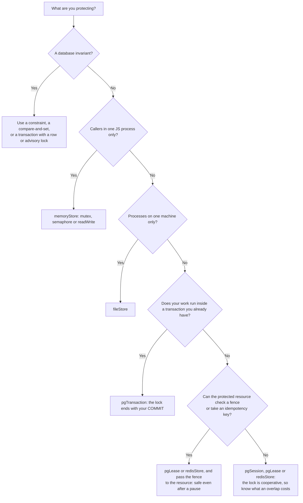

# @arki/lock

Distributed locks and semaphores for TypeScript. One API over memory, Postgres, Redis and file stores.

- **Four verbs, three lock types.** `tryRun`, `run`, `tryAcquire` and `acquire` work on a mutex, a semaphore and a read/write lock.
- **Contention is a value.** A lock that someone else holds is the `LockHeld` failure (`lock.held`, from `@arki/failure`), returned, not thrown.
- **Every store says what it promises.** Each store has a `guarantees` object. The handle types follow it, so a method a store cannot back does not exist on the handle.
- **Leases look after themselves.** They renew on their own, abort your callback's `signal` when ownership is lost, and hand out fencing tokens where the store can.
- **Runs where your code runs.** Node, Bun and Deno. The memory store also runs in the browser and on Hermes.

An honest note up front: a lock keeps jobs apart. It does not make a write safe by itself. Read [Which lock do I need](#which-lock-do-i-need) and the [production checklist](#production-checklist).

## Install

```sh
bun add @arki/lock
```

The root package has no database code. Each store lives on its own entry point, and you install only the client it needs.

Peers are optional. Each entry point lists the client it needs in the Public imports table.

## Quick start

```ts from="examples/nightly.ts#run-once"
import { createLocks, LockHeld } from '@arki/lock';
import { memoryStore } from '@arki/lock/memory';

const locks = createLocks({ store: memoryStore(), namespace: 'billing' });

/** Send invoices unless another caller is already doing it. */
export async function sendInvoices(send: () => Promise<number>): Promise<string> {
  const result = await locks.mutex('send-invoices').tryRun(async ({ signal }) => {
    signal.throwIfAborted(); // aborts if the lock is lost
    return send();
  });
  if (LockHeld.is(result)) return 'skipped: another caller holds the lock';
  return `sent ${result}`;
}
```

`tryRun` runs the callback when the lock is free and returns `LockHeld` when it is not. With two callers at once, one runs and the other is told:

```ts from="examples/nightly.ts#overlap"
/** Two callers at once: one runs, the other is told the lock is busy. */
export async function overlap(): Promise<[string, string]> {
  const first = sendInvoices(async () => {
    await new Promise(resolve => setTimeout(resolve, 20)); // the first caller is slow
    return 3;
  });
  await Promise.resolve();
  const second = await sendInvoices(async () => 3);
  return [await first, second];
}
```

## When not to use this

- **To protect a database invariant.** Use a constraint, a conditional write or a transaction. A lock decides who starts; the database decides what commits.
- **For a write you cannot undo and cannot fence.** A lock keeps jobs apart. A paused process can still write after its lease ended unless the resource checks a fence.
- **For rate limits or throttles.** A limiter is not a lock.
- **For a queue's unique jobs.** That belongs to the queue, built on `tryAcquire`.
- **For quorum across independent Redis nodes.** Redlock is not built. See Not building.

## Runtime support

Node, Bun and Deno. The memory store also runs in browsers and on Hermes. The Postgres, Redis and file stores need their client and a server runtime.

## Public imports

| Entry point           | What it has                                                              | Optional peer you install |
| --------------------- | ------------------------------------------------------------------------ | ------------------------- |
| `@arki/lock`          | `createLocks`, `LockError`, types                                        | none                      |
| `@arki/lock/memory`   | `memoryStore`                                                            | none                      |
| `@arki/lock/pg`       | `pgSession`, `pgTransaction`                                             | `drizzle-orm`             |
| `@arki/lock/pg/lease` | `pgLease`, `ensureLockTable`                                             | `drizzle-orm`             |
| `@arki/lock/redis`    | `redisStore`                                                             | `ioredis`                 |
| `@arki/lock/file`     | `fileStore`                                                              | none                      |
| `@arki/lock/dot`      | `locks()` plugin for `@arki/dot`                                         | `@arki/dot`               |
| `@arki/lock/testing`  | manual scheduler, `testStore`, store conformance suite, replica property | `vitest`, `fast-check`    |

## Which lock do I need

Pick the narrowest tool that protects the thing you care about. A lock decides who may start. A constraint, a conditional write or an idempotency key decides what is allowed to commit.



Rules of thumb:

- One job at a time across replicas, with Postgres: `pgSession` (the lock dies with the connection) or `pgLease` (a fence, and it lasts a lease).
- At most N at a time (an API quota, a worker pool): `semaphore`.
- Many readers or one writer: `readWrite`.
- One leader among replicas: `mutex(key).lead(fn)` on a lease store.

## The verbs

Every lock handle has the same four verbs. `mutex`, `semaphore` and `readWrite` differ only in what they exclude.

| Verb                   | What it does                                                                | Result                                                                          |
| ---------------------- | --------------------------------------------------------------------------- | ------------------------------------------------------------------------------- |
| `tryRun(fn, opts?)`    | One attempt. Runs `fn` if the lock is free, releases after.                 | the value of `fn`, or `LockHeld`                                                |
| `run(fn, opts?)`       | Waits up to `wait`, or until `signal` aborts. Runs `fn`, releases after.    | the value of `fn`, or `LockHeld` when still busy after `wait`; throws `aborted` |
| `tryAcquire(opts?)`    | One attempt. You release yourself.                                          | a `Guard`, or `LockHeld`                                                        |
| `acquire(opts?)`       | Waits like `run`. You release yourself.                                     | a `Guard`, or `LockHeld` when still busy after `wait`; throws `aborted`         |
| `lead(fn, { signal })` | Campaigns until `signal` aborts. Runs `fn` while leader. Lease stores only. | settles when `signal` aborts                                                    |

Call options:

| Option        | Applies to       | Meaning                                                                                                                                                                                                                                                   |
| ------------- | ---------------- | --------------------------------------------------------------------------------------------------------------------------------------------------------------------------------------------------------------------------------------------------------- |
| `wait`        | `run`, `acquire` | How long to wait. Optional on a process-scope store, where no `wait` means wait forever. On any other scope you must pass `wait` or `signal` (the types enforce it).                                                                                      |
| `signal`      | all              | Aborts the wait. On `tryRun` and `tryAcquire` it aborts the attempt, and they throw `aborted` if the signal is already aborted or aborts during the store call. A caller's signal also aborts `ctx.signal`, with the caller's reason (not a `LockError`). |
| `holdAtLeast` | all              | Keep the lock at least this long after it was taken, even if `fn` is quicker. Closes the gap where a replica with a slow clock reruns a sub-second job. `run` resolves after the release, so after the hold.                                              |
| `onLost`      | all              | `'abort'` (default) or `'ignore'`. What `run` does when the lock was lost but `fn` returned. See [failure behaviour](#failure-behaviour).                                                                                                                 |
| `weight`      | semaphore only   | Permits to take. A positive integer up to the limit. Default 1.                                                                                                                                                                                           |

A duration is a number of milliseconds, or a string with the unit `ms`, `s`, `m` or `h`: `'250ms'`, `'5s'`, `'2m'`, `'1h'`. There are no days or weeks on purpose.

### Mutex

```ts
import { drizzle } from 'drizzle-orm/node-postgres';
import { Pool } from 'pg';

import { createLocks, LockHeld } from '@arki/lock';
import { pgSession } from '@arki/lock/pg';

const pool = new Pool({ connectionString: process.env['DATABASE_URL'] });
const db = drizzle({ client: pool });
const locks = createLocks({ store: pgSession(db), namespace: 'billing' });

// Skip if another replica is already running it.
const outcome = await locks.mutex('nightly-report').tryRun(async () => {
  return 'done';
});
if (LockHeld.is(outcome)) console.info('another replica has it');

// Wait up to 5 seconds. Returns LockHeld if it never frees.
const total = await locks.mutex('close-books').run(async () => 42, { wait: '5s' });
if (LockHeld.is(total)) console.info(total.remediation, total.data.waitedMs);

// Hold the guard yourself. `await using` releases at the end of the block.
const guard = await locks.mutex('export').acquire({ wait: '5s' });
if (!LockHeld.is(guard)) {
  await using held = guard;
  console.info(held.held, held.key.name);
}
```

A guard has `key`, `signal`, `held`, `fence` and `release()`. On a lease store it also has `expiresAt` and `extend()`. `held` turns false when the lock is released, lost, or when the local deadline passes, even before any timer fires. `release()` is safe to call twice and checks the owner. `extend()` logs and resolves when the store errors or times out; it rejects only with `lost`. A resolved `extend()` does not prove the lease was extended.

### Semaphore

A semaphore lets up to `limit` callers in at once. A call can take more than one permit with `weight`.

```ts
import { createLocks, LockHeld } from '@arki/lock';
import { memoryStore } from '@arki/lock/memory';

const locks = createLocks({ store: memoryStore(), namespace: 'media' });
const transcoders = locks.semaphore('transcode', { limit: 4 });

await transcoders.run(async () => 'small job'); // takes 1 of 4
await transcoders.run(async () => 'big job', { weight: 3 }); // takes 3 of 4
const maybe = await transcoders.tryRun(async () => 'try', { weight: 2 });
console.info(LockHeld.is(maybe));
```

- `limit` and `weight` are positive integers up to 2^31-1. Anything else is a `config` error.
- The store checks `limit` only while the key has live holders. Once the key is empty, a new limit is accepted. A bad deploy cannot wedge a key.
- Only a semaphore call takes `weight`.

### Read/write lock

Many readers, or one writer. `readWrite(key)` has a `read` side and a `write` side. Each side has the four verbs.

```ts
import { createLocks } from '@arki/lock';
import { memoryStore } from '@arki/lock/memory';

const locks = createLocks({ store: memoryStore(), namespace: 'cache' });
const index = locks.readWrite('search-index');

const hits = await index.read.run(async () => ['a', 'b']);
await index.write.run(async () => {
  // No reader and no other writer is inside.
});
console.info(hits);
```

- There is no automatic read-to-write upgrade. Two upgraders would deadlock. Release the read, then take the write.
- Only the memory store lets a waiting writer stop new readers (`writerPreference`). On Postgres and Redis a steady stream of readers can starve a writer.

### One name, three locks

`mutex('a')`, `semaphore('a', ...)` and `readWrite('a')` never block each other. Each family has its own key tag (see [Key encoding](#key-encoding)).

### Leader election: `lead`

`lead` exists only on handles of a lease store. It runs `fn` while this process is the leader.

```ts
import type { LeaseDb } from '@arki/lock/pg/lease';
import { createLocks } from '@arki/lock';
import { ensureLockTable, pgLease } from '@arki/lock/pg/lease';

declare const db: LeaseDb;
await ensureLockTable(db);
const locks = createLocks({ store: pgLease(db, { ttl: '30s' }), namespace: 'billing' });

const shutdown = new AbortController();
void locks.mutex('leader').lead(
  async ({ signal, fence }) => {
    console.info('leading with fence', fence);
    await new Promise<void>(resolve => {
      signal.addEventListener('abort', () => resolve(), { once: true });
    });
  },
  { signal: shutdown.signal },
);
// later: shutdown.abort() steps down and stops campaigning
```

- `fn` should run for as long as it wants to lead. Returning from `fn` steps down.
- After any term, the old leader waits one full beat (`ttl / 3`) before it campaigns again.
- `fn` must honour its `signal`. The signal aborts no later than the local deadline, or earlier when a renewal is refused. The deadline is counted from the time the request was sent, so it is never after the store's expiry, unless your event loop stalls (the timer is late then).
- A second `fn` never starts while the first still runs.
- `lead` never rejects. An error thrown by `fn` is logged and swallowed, and the loop campaigns again after one beat. Without a `signal` it campaigns forever.
- `locks.counters` has `leadAcquired` and `leadLost`.

## Stores and guarantees

A store is a small object with `acquire`, `release` and, for leases, `extend`. It also declares a `guarantees` object. The types of every handle come from it.

| Field              | Values                                       | Meaning                                                                                                                                  |
| ------------------ | -------------------------------------------- | ---------------------------------------------------------------------------------------------------------------------------------------- |
| `kind`             | `hold`, `lease`                              | A **hold** lasts as long as a connection or a transaction. A **lease** lasts until it expires, so the manager renews it every `ttl / 3`. |
| `scope`            | `process`, `host`, `cluster`                 | Who is kept apart: callers in this process, processes on this machine, or processes anywhere.                                            |
| `wait`             | `native`, `wake`, `poll`, `none`             | How a blocked caller waits: inside the store, woken by a signal, by polling, or `none` (the store cannot wait; callers only try once).   |
| `shared`           | boolean                                      | `readWrite()` exists.                                                                                                                    |
| `permits`          | boolean                                      | `semaphore()` exists.                                                                                                                    |
| `fence`            | `durable`, `best-effort`, `process`, `false` | How reliable the fencing token is. `false` means none, and `fence` is `undefined`.                                                       |
| `releasedOnCrash`  | `immediate`, `after-ttl`                     | How long a crashed holder keeps the lock.                                                                                                |
| `clock`            | `store`, `host`, `none`                      | Whose clock decides expiry.                                                                                                              |
| `poolerSafe`       | boolean                                      | Works behind a connection pooler.                                                                                                        |
| `releasedBy`       | `'transaction'` or absent                    | The lock ends with the caller's transaction, so a guard has no `release`.                                                                |
| `writerPreference` | boolean or absent                            | A waiting writer stops new readers.                                                                                                      |

The values each store declares today:

| Factory                       | kind  | scope   | wait                        | readWrite               | semaphore | fence       | released on crash       | clock | runtimes                         |
| ----------------------------- | ----- | ------- | --------------------------- | ----------------------- | --------- | ----------- | ----------------------- | ----- | -------------------------------- |
| `memoryStore()`               | hold  | process | wake                        | yes (writer preference) | yes       | process     | immediate               | none  | node, bun, deno, browser, hermes |
| `pgSession(db)`               | hold  | cluster | native                      | yes                     | no        | none        | immediate               | none  | node, bun, deno                  |
| `pgTransaction(tx)`           | hold  | cluster | native                      | yes                     | no        | none        | immediate (on rollback) | none  | node, bun, deno                  |
| `pgLease(db, { ttl })`        | lease | cluster | poll, or wake with `listen` | no                      | yes       | durable     | after ttl               | store | node, bun, deno                  |
| `redisStore(client, { ttl })` | lease | cluster | wake, or poll               | yes                     | yes       | best-effort | after ttl               | store | node, bun, deno                  |
| `fileStore(dir)`              | lease | host    | poll                        | no                      | no        | none        | after `stale`           | host  | node, bun, deno                  |

`pgTransaction` also declares `releasedBy: 'transaction'`. `redisStore` reports `wait: 'poll'` once its pub/sub channel has failed or was switched off.

Each store's entry also exports its guarantees as a value, for tests: `memoryGuarantees`, `pgSessionGuarantees`, `pgTransactionGuarantees`, `pgLeasePollGuarantees`, `pgLeaseWakeGuarantees`, `redisGuarantees` (with `wait: 'wake'`) and `fileGuarantees`.

What the words cost you:

- **Fence `durable`**: the number only grows, even across restarts of every process. Safe to compare in a database.
- **Fence `best-effort`** (Redis): it grows with an `INCR`, but a Redis restart or failover can reset it.
- **Fence `process`** (memory): it grows inside this process only.
- **Fence none**: the store gives no token. Lean on the other lines of the [checklist](#production-checklist).
- **Hold stores** need no `ttl`. The lock ends when its connection or transaction ends.
- **Lease stores** need a `ttl` on the store itself (`pgLease(db, { ttl })`). The floor is 1 s. The manager renews every `ttl / 3`.

### `memoryStore`

For one process, and for tests. A release hands the lock straight to the first waiter in line (first in, first out), so a contended lock does not wake every waiter.

- Nested reads of one key deadlock while a writer waits. That is the price of writer preference.
- There is no queue reservation for heavy semaphore waiters: a big `weight` can wait behind a stream of small ones.
- It does not detect a callback that locks its own key again. That callback waits for itself.
- `peek(key)` shows the holder of a key, for tests and debugging.

### `pgSession` and `pgTransaction`

Both use Postgres advisory locks. A key becomes two signed 32-bit integers (see [Key encoding](#key-encoding)).

`pgSession(db)` needs a `db` with `transaction(cb)`: a Drizzle database on node-postgres, postgres.js or PGlite works.

- **How it works.** Each held lock owns one open transaction on one pooled connection. The lock is a transaction-level advisory lock, so ending the transaction (release, crash, dead connection) frees it. No unlock statement can fail and leave the lock behind.
- **The keep-alive beat.** While a lock is held, the pinned connection runs a short `pg_sleep` in a loop. If the connection dies, that query fails and the guard learns the lock is lost. The first beat is 1 ms, and each next beat doubles up to 200 ms. A release has to wait for the beat in flight, so a short hold ends in a few milliseconds, not a whole long beat. A beat that does not answer in 5 s counts as a silent network, and the hold is reported lost.
- **Server timeouts are switched off on that transaction only.** `pgSession` turns off `idle_in_transaction_session_timeout`, `statement_timeout` and (Postgres 17) `transaction_timeout` inside its own pinned transaction. Your other queries keep their settings.
- **Pool size.** Each held lock and each waiter pins one connection. Size the pool for your jobs plus your locks.
- **Error events.** Attach `pool.on('error', handler)` and also `pool.on('connect', client => client.on('error', handler))`. node-postgres emits `error` on a checked-out client whose backend was terminated. A lock store cannot attach that listener for you.
- **PGlite and in-process databases.** Use `pgSession(db, { keepAlive: false })`. There is no connection to lose, and a beat would block the thread. Grants then have no `lost`. PGlite advisory locks are local to the process, so it can check the SQL shape but not exclusion between replicas.
- **Behind PgBouncer.** It works: the lock and its transaction stay on one server connection.

`pgTransaction(tx)` takes the lock inside a transaction you already have.

- The lock lasts until your `COMMIT` or `ROLLBACK`. A guard has no `release`; the types leave the method off.
- It is re-entrant inside one transaction (advisory locks belong to a session). Exclusion is between transactions. A read then a write of the same key in one transaction is granted.
- A `ROLLBACK TO SAVEPOINT` taken before the acquire does release the lock.
- An aborted wait returns only after the store is done with your transaction (at most 1 s).
- `legacyKeys` applies to mutexes only.

### `pgLease`

A lease row in a table, with a fence that never goes backwards. Time comes from the database clock (`clock_timestamp()`, never `now()`, which is the start of your transaction).

```ts
import type { LeaseDb } from '@arki/lock/pg/lease';
import { createLocks } from '@arki/lock';
import { ensureLockTable, pgLease } from '@arki/lock/pg/lease';

declare const db: LeaseDb;
await ensureLockTable(db, 'app.locks'); // same table name as the store below; safe to call on every boot, from every replica at once
const locks = createLocks({ store: pgLease(db, { ttl: '30s', table: 'app.locks' }), namespace: 'billing' });
console.info(locks.store.guarantees.fence); // 'durable'
```

- `ensureLockTable(db)` creates the table. Or copy `LEASE_TABLE_SQL` (or `leaseTableSql('name')`) into your own migration. The default table is `arki_lock`.
- Pass an autocommit pool or database, never a transaction handle. A rollback would undo an acquire and give the same fence out twice. The first acquire checks this and throws `config`.
- Release keeps the row (`token = NULL`). If it deleted the row, the fence would start again at 1.
- `wait` is `'poll'` unless you give `listen: () => pool.connect()`. With `listen`, waiters wake on release through `LISTEN`/`NOTIFY`. `listen` must be a direct connection: `LISTEN` hears nothing through PgBouncer in transaction mode.
- A semaphore key is one row. Its holders live in a `holders jsonb` column on that row. `ensureLockTable` adds the column only when it is missing, so a boot does not take an `ACCESS EXCLUSIVE` lock.

### `redisStore`

```ts
import { Redis } from 'ioredis';

import { createLocks } from '@arki/lock';
import { redisStore } from '@arki/lock/redis';

const client = new Redis(process.env['REDIS_URL'] ?? 'redis://localhost:6379');
const locks = createLocks({ store: redisStore(client, { ttl: '30s' }), namespace: 'billing' });
console.info(locks.store.guarantees.wait);
```

- Waiters wake through pub/sub on a second connection by default. `{ wake: 'poll' }` uses no second connection.
- Use an eviction policy that never evicts lock keys: `maxmemory-policy noeviction`. If Redis evicts a lock key, two owners are possible.
- Keys use the hash tag `{<encoded key>}`, so every Redis key of one lock lives in one cluster slot. A `}` in a namespace or name shortens the hash tag, which puts many names in one hot slot. Avoid `}`.
- Fence counters never expire. There is one per lock name and primitive that you have ever used.
- A semaphore and a read/write lock share that lock's hash tag, so all Redis keys of one lock sit in one slot. ioredis `keyPrefix` works; the wake channel is passed to the script as an argument.
- There is no quorum across independent Redis nodes. See [Not building](#not-building).

### `fileStore`

For several processes on one machine, with no database.

```ts
import { createLocks } from '@arki/lock';
import { fileStore } from '@arki/lock/file';

const locks = createLocks({
  store: fileStore('/var/run/myapp/locks', { stale: 10_000 }),
  namespace: 'backup',
});
console.info(locks.store.guarantees.scope); // 'host'
```

- A lock is a directory with an owner file. The manager's renewal (every `stale / 3`, a touch of the file's mtime) is the heartbeat. There is no `update` option. `stale` is the lease length (default 10 s).
- It relies on POSIX `rename` semantics. Windows is untested.
- `clock: 'host'`: a wall-clock jump forward by more than `stale` makes every live lock look stale. Run NTP, and do not step the clock.
- The least safe `stale` depends on the file system's mtime resolution: at least 2 s on file systems with 1 s mtimes (HFS+, ext3), at least 4 s on FAT. The default 10 s is safe everywhere.
- Leftover `.tmp-*`, `.dead-*` and stepped-past guard directories from crashed processes are never swept. Their names are unique, so they never block anyone. They only pile up.
- There is no fence. A renewal that lands about two thirds of a lease late can touch a successor's lock: the old owner's lease ran out, a new owner took the directory, and the late touch refreshes the new owner's file.

## Failure behaviour

Locks return a failure for contention and throw for everything else. A busy lock is not an error. `tryRun`, `run`, `tryAcquire` and `acquire` return the `LockHeld` failure (from `@arki/failure`) when the lock is busy:

| Code        | Status | Data                                                                                                               | Returned by                                                               |
| ----------- | ------ | ------------------------------------------------------------------------------------------------------------------ | ------------------------------------------------------------------------- |
| `lock.held` | 409    | `waitedMs` (0 for `tryRun` and `tryAcquire`), and `key` (the full key) only when `createLocks` got `logKeys: true` | `tryRun`, `tryAcquire`, and `run`, `acquire` when still busy after `wait` |

Check it with `LockHeld.is(result)`, or handle it with `match` from `@arki/failure`.

Every other failure on purpose is a thrown `LockError` with a stable `code`. Match on `code`, never on the message. `errorCode` is the stable id, and `remediation` is one sentence on what to do. `ARKI_LOCK_E001` was `held`; it is not reused.

| `code`        | `errorCode`      | When                                                                                                                              | Thrown by                                |
| ------------- | ---------------- | --------------------------------------------------------------------------------------------------------------------------------- | ---------------------------------------- |
| `aborted`     | `ARKI_LOCK_E002` | Your `signal` aborted the wait or the attempt. The callback never ran.                                                            | `run`, `acquire`, `tryRun`, `tryAcquire` |
| `lost`        | `ARKI_LOCK_E003` | Ownership was lost while the callback ran. The callback may have had side effects. Nothing retries it.                            | `run`, `tryRun`                          |
| `store`       | `ARKI_LOCK_E004` | The backend failed. It is never read as free or as held.                                                                          | any                                      |
| `release`     | `ARKI_LOCK_E005` | `guard.release()` failed or answered `unknown`.                                                                                   | `guard.release()` only                   |
| `config`      | `ARKI_LOCK_E006` | Bad input or setup: empty key, bad duration, ttl below 1 s, conflicting semaphore limit, a transaction handle given to `pgLease`. | any                                      |
| `unsupported` | `ARKI_LOCK_E007` | Reserved: a store lacks a capability the types could not see. Nothing throws it today.                                            | any                                      |

Extra fields: `outcome` on `store` (`'not-acquired'` or `'unknown'`, meaning ownership may exist remotely), `detectedBy` on `lost` (`'renewal'`, `'deadline'` or `'connection'`), `method` (which store call failed), `timeoutMs`, and `suppressed`.

The rules:

1. **Contention is a value.** Every verb returns `LockHeld` for a busy lock; none throws for it. If your `fn` can itself return `LockHeld` (it calls another lock), the caller cannot tell which lock was busy: handle the inner one inside `fn`. Any other failure your `fn` returns comes back as the value, and `LockHeld.is` is false for it.
2. **Your error wins.** If your callback throws, that error is what the caller sees. A loss or a failed release that happened at the same time is attached to it as `suppressed`.
3. **Loss aborts `signal`.** When the manager learns the lock is gone (a refused renewal, a passed local deadline, a closed connection), it aborts `ctx.signal` with the `LockError` as the reason. Pass `signal` to the work you do.
4. **A callback that returns after loss.** `run` and `tryRun` throw `lost` by default. This includes a loss during the `holdAtLeast` wait after `fn` finished. Pass `onLost: 'ignore'` to get the value anyway.
5. **A failed release after a successful callback is not thrown.** The callback did its job, so you get its value. The failure is logged at error level, counted in `locks.counters.releaseErrors`, and passed to the `onReleaseError` hook you can give `createLocks`. On a lease store the key frees itself after `ttl`.
6. **A slow store is bounded.** Store calls have a time limit, `storeTimeout`, default `'10s'`. `pgTransaction` is the exception: its acquire has no timer, so a silent connection can hang it. On `pgSession` (native wait) the bound for an acquire is `storeTimeout` plus your `wait`. A call that exceeds it is a `store` error with `outcome: 'unknown'`. It is never `LockHeld`. A grant that arrives after the limit is given back, so a late answer cannot leave a lock behind. Set `storeTimeout` above the slowest healthy answer of your store.

```ts
import { createLocks, LockError } from '@arki/lock';
import { memoryStore } from '@arki/lock/memory';

const locks = createLocks({
  store: memoryStore(),
  namespace: 'billing',
  storeTimeout: '5s',
  onReleaseError: error => console.warn('release failed', error.errorCode, error.remediation),
});

try {
  await locks.mutex('payout').run(async ({ signal }) => {
    signal.throwIfAborted();
    return 'paid';
  });
} catch (error) {
  if (error instanceof LockError && error.code === 'lost') {
    // The job may have run in part. Check the outcome; do not blindly retry.
    console.error(error.detectedBy);
  } else {
    throw error;
  }
}
console.info(locks.counters.releaseErrors);
```

`locks.counters` has `releaseErrors`, `leadAcquired` and `leadLost`. Raw keys stay out of logs unless you pass `logKeys: true` to `createLocks` (the Dot plugin has no such option).

### Using the fence

A fence is a number that only grows. Hand it to the thing you protect, and let that thing refuse an older number. Then a paused process that wakes up after its lease expired cannot overwrite newer work.

```ts
import { sql } from 'drizzle-orm';

import type { LeaseDb } from '@arki/lock/pg/lease';
import { createLocks } from '@arki/lock';
import { pgLease } from '@arki/lock/pg/lease';

declare const db: LeaseDb;
const locks = createLocks({ store: pgLease(db, { ttl: '30s' }), namespace: 'billing' });

await locks.mutex('report').run(
  async ({ signal, fence }) => {
    signal.throwIfAborted();
    // The check and the write are ONE statement. A separate read would race.
    await db.execute(
      sql`UPDATE reports SET body = 'x', fence = ${fence.toString()}::bigint
          WHERE id = 1 AND fence <= ${fence.toString()}::bigint`,
    );
  },
  { wait: '10s' },
);
```

## Dot integration

`@arki/lock/dot` is a plugin for [`@arki/dot`](https://www.npmjs.com/package/@arki/dot). It builds the store at boot, hands the typed `Locks` to features, and closes the store when the app stops.

```ts skip="needs @arki/schedule, a Postgres pool and DATABASE_URL"
import { drizzle } from 'drizzle-orm/node-postgres';
import { Pool } from 'pg';

import type { LeaseDb } from '@arki/lock/pg/lease';
import type { Locker } from '@arki/schedule';
import { feature } from '@arki/dot/feature';
import { defineApp, plugin, service } from '@arki/dot/plugin';
import { locks } from '@arki/lock/dot';
import { pgLease } from '@arki/lock/pg/lease';
import { schedule, schedules } from '@arki/schedule/dot';

// Your database, as a Dot service named `db`.
const database = plugin({
  name: 'database',
  provides: { db: (): LeaseDb => drizzle({ client: new Pool({ connectionString: process.env['DATABASE_URL'] }) }) },
});

// A feature asks for the `locks` service, and for locks on its schedules.
const needs = { locks: service<Locker>() };
const billing = feature('billing', {
  needs,
  use: [
    schedules(needs, [
      // lock: true  -> the key is the schedule name, held at least 1 s
      { name: 'send-invoices', cron: '*/5 * * * *', lock: true, handler: () => 'sent' },
      // a string shares one key, so two jobs exclude each other
      { name: 'close-books', cron: '0 3 * * *', lock: 'ledger', handler: () => 'closed' },
      // the object form sets the key and the minimum hold
      { name: 'quick', every: '1m', lock: { key: 'quick', holdAtLeast: 0 }, handler: () => 'ok' },
    ]),
  ],
});

export const app = defineApp('billing')
  .use(database)
  .use(
    locks({
      namespace: 'billing',
      needs: { db: service<LeaseDb>() },
      store: ({ db }) => pgLease(db, { ttl: '30s' }),
      // allowProcessScope: true, // only for an app that runs one replica
    }),
  )
  .features([billing])
  .entrypoints(schedule({}));
```

- **`allowProcessScope`.** `locks()` refuses a process-scope store (such as `memoryStore`) when `NODE_ENV` is `production`, because every replica would then run every job. The boot fails with a `DotLifecycleError` whose `cause` is a `LockError{code:'config'}`. Set `allowProcessScope: true` only for an app that runs one replica.
- **`holdAtLeast` defaults to 1 s on a schedule.** `lock: true` and `lock: 'key'` keep the key at least 1 s after the job started. A job that ends in 10 ms would otherwise free the key at once, and a replica whose clock is a little behind would start the same tick again. `holdAtLeast: 0` turns it off. Because the hold counts, `trigger()` and the shutdown drain wait for the release, so a locked run takes at least 1 s.
- **The handler's second argument has `run.lock`.** It is `{ signal, fence }`. Pass `signal` to long work.
- **Counters on the schedule runtime**: `lockContention` (the lock was held elsewhere), `lockFailures` (the store failed) and `lockLost`. A failed release is in `locks.counters.releaseErrors` instead.
- **`dot explain`** shows `lock <key>` for each locked schedule, and `NO LOCK` for one that runs on every replica. **`dot doctor`** shows the full line after boot: `lock <ns>:<key>  [<store> · <kind> · <scope> · crash→<bound> · fence <level> · hold≥1s]`.
- Shutdown order is: stop schedules, drain running callbacks, release locks, dispose the store.

## Rolling deploy: `legacyKeys`

`pgSession` and `pgTransaction` normally lock the pair of 32-bit integers from [Key encoding](#key-encoding). If your code already takes advisory locks with `hashtext('<namespace>:<name>')`, that is a different key space. The two spaces do not exclude each other.

`legacyKeys: true` makes `@arki/lock` lock `hashtext('<namespace>:<name>')` too, so old and new replicas keep excluding each other while you roll out.

```ts
import type { LockableDb } from '@arki/lock/pg';
import { createLocks } from '@arki/lock';
import { pgSession } from '@arki/lock/pg';

declare const db: LockableDb;
// Step 1: roll out the new package with legacyKeys. Old and new replicas now share one key space.
const locks = createLocks({ store: pgSession(db, { legacyKeys: true }), namespace: 'billing' });
console.info(locks.store.name);
```

The recipe:

1. Ship the new code with `legacyKeys: true`. Use the same `namespace` and name that your old code hashed.
2. Once no old replica runs, you may stay on legacy keys for good. It costs nothing.
3. To move to the default key space, every replica must switch at the same time. A rolling deploy of that change has a window where old and new replicas do not exclude each other. Either stop the old replicas before you start the new ones, or do it only for jobs that are safe to overlap once.
4. `legacyKeys` is mutex-only. Semaphores and read/write locks always use the default space.

## Key encoding

A key is `(namespace, name)`. It is encoded so that two different pairs can never collide, the way `` `${ns}:${name}` `` can (`('a:b', 'c')` against `('a', 'b:c')`).

```text
mutex      1:<len>:<namespace>:<len>:<name>
semaphore  1s:<len>:<namespace>:<len>:<name>
readWrite  1rw:<len>:<namespace>:<len>:<name>
```

- `<len>` is the UTF-8 byte length of the part that follows it.
- A namespace or name is non-empty, at most 512 UTF-8 bytes, and has no lone surrogates. Keys are case-sensitive and Unicode-exact. Anything else is a `config` error.
- The tag is part of the encoding, so `mutex('a')`, `semaphore('a', ...)` and `readWrite('a')` are three separate locks on every store.
- `@arki/lock` hashes the encoded text in TypeScript with FNV-1a (64-bit) over its UTF-8 bytes. The two signed 32-bit halves, high then low, are the arguments of `pg_advisory_xact_lock(int4, int4)` (and the `try` and `shared` variants). You can see them as `classid` and `objid` in `pg_locks`.
- The hash is pure TypeScript, so it runs on every runtime, Hermes included.

**These values are published and will not change.** If one moved, two replicas on different versions would stop excluding each other. They come from `src/key.test.ts`.

| Kind      | Namespace    | Name                   | Encoded                                   | Digest (hex)       | `hi`        | `lo`        |
| --------- | ------------ | ---------------------- | ----------------------------------------- | ------------------ | ----------- | ----------- |
| mutex     | `a`          | `b`                    | `1:1:a:1:b`                               | `27e5fb35a8202ebd` | 669383477   | -1474285891 |
| mutex     | `a:b`        | `c`                    | `1:3:a:b:1:c`                             | `740048a6956bced8` | 1946175654  | -1788096808 |
| mutex     | `a`          | `b:c`                  | `1:1:a:3:b:c`                             | `97e26ae3cf85e34c` | -1746769181 | -813309108  |
| mutex     | `avocabo`    | `send-digest`          | `1:7:avocabo:11:send-digest`              | `2f5bc307f17b9f09` | 794542855   | -243556599  |
| mutex     | `kapodopera` | `tracking:usr_1:cnt_2` | `1:10:kapodopera:20:tracking:usr_1:cnt_2` | `659787ce2c15fbf2` | 1704429518  | 739638258   |
| mutex     | `ns`         | `héllo wörld`          | `1:2:ns:13:héllo wörld`                   | `eaac57ef151cc82e` | -357804049  | 354207790   |
| mutex     | `ns`         | `日本語🔒`             | `1:2:ns:13:日本語🔒`                      | `3df2654d8d0ea9f0` | 1039295821  | -1928418832 |
| semaphore | `a`          | `b`                    | `1s:1:a:1:b`                              | `cf03467b858898fc` | -821868933  | -2054645508 |
| semaphore | `avocabo`    | `send-digest`          | `1s:7:avocabo:11:send-digest`             | `b2f5d6d605248d52` | -1292511530 | 86281554    |
| readWrite | `a`          | `b`                    | `1rw:1:a:1:b`                             | `fd3d1d9f7a5ca1b2` | -46326369   | 2052891058  |
| readWrite | `avocabo`    | `send-digest`          | `1rw:7:avocabo:11:send-digest`            | `74be357e07e03548` | 1958622590  | 132134216   |

Redis uses the encoded text inside a hash tag, as `{1:1:a:1:b}`. `fileStore` names its lock directory from a readable part of the name plus a SHA-256 of the encoded key.

## Production checklist

Read this before you ship a lock to production.

- **Use a shared store.** A process-scope store keeps only this process apart. With more than one replica, use `pgSession`, `pgLease` or `redisStore`.
- **Run the conformance suite against your real server.** Call `describeStoreContract` with `concurrent` on in CI, against the same server version you run in production. A mock cannot show you a race.
- **Write the key yourself.** Name keys on purpose, with a namespace per app. Do not derive a key from a class or function name. A rename or a minifier would change it, and two versions would stop excluding each other.
- **Set `ttl` above a store round trip and above the longest event-loop stall.** A lease renews every `ttl / 3`. If a renewal is late by more than two thirds of a `ttl`, the lease can expire while the process is alive. The floor is 1 s. Something like 30 s is common.
- **Set `storeTimeout` above the slowest healthy answer.** Too low, and healthy calls turn into `store` errors.
- **Missed ticks are not caught up.** A lock does not make up for a job that did not run. Write jobs that do what is due now, not what one tick means.
- **Pass `signal` downstream.** The signal aborts when the lock is lost. Give it to `fetch`, to queries and to child work, so they stop.
- **Fence irreversible writes.** For a write you cannot undo, put the fence in the same statement as the write (see [Using the fence](#using-the-fence)). Without a fence, a process that paused longer than its lease can still write after another process took over.
- **Alert on `lost`.** Watch for `LockError{code:'lost'}` and for `lockLost` on schedules. Frequent loss means your `ttl` is too short or your event loop stalls.
- **Alert on `releaseErrors`.** It stays at zero when things are healthy.
- **Shut down in this order:** stop new work, drain running callbacks, release locks, dispose the store. The Dot plugin does this for you.
- **Redis:** turn on persistence if you want locks to survive a restart, and set `maxmemory-policy noeviction`. A Redis restart or failover can lose locks and reset the best-effort fence.
- **Postgres pool size:** one short statement for each renewal of each held lock, plus one for each tick. With `pgSession`, each held lock pins a connection, so size the pool for jobs plus locks.
- **Run NTP** on every host. `fileStore` trusts the host clock. Lease stores that use the store's clock are not affected by skew between your processes.

## Writing a store

A store is any object with this shape. The conformance suite (below) tells you if yours is right.

```ts
import type { Grant, Guarantees, Key, ReleaseOutcome, Store } from '@arki/lock';

// A toy store, only to show the shape.
const guarantees = {
  kind: 'hold',
  scope: 'process',
  wait: 'poll',
  shared: false,
  permits: false,
  fence: false,
  releasedOnCrash: 'immediate',
  clock: 'none',
  poolerSafe: true,
  runtimes: ['node', 'bun', 'deno'],
} as const satisfies Guarantees;

export function toyStore(): Store<typeof guarantees> {
  const owners = new Map<string, string>();
  return {
    name: 'toy',
    guarantees,
    acquire(key: Key, req): Promise<Grant | undefined> {
      if (owners.has(key.full)) return Promise.resolve(undefined);
      owners.set(key.full, req.token);
      return Promise.resolve({ key, token: req.token });
    },
    release(grant: Grant): Promise<ReleaseOutcome> {
      if (owners.get(grant.key.full) !== grant.token) return Promise.resolve('not-owner');
      owners.delete(grant.key.full);
      return Promise.resolve('released');
    },
  };
}
```

The port:

| Member                                | Required                 | Meaning                                                                                            |
| ------------------------------------- | ------------------------ | -------------------------------------------------------------------------------------------------- |
| `name`, `guarantees`                  | yes                      | Shown in logs and in `dot explain`. The handle types derive from `guarantees`.                     |
| `acquire(key, req)`                   | yes                      | One atomic attempt. `undefined` means held by someone else. `req.token` is fresh for each attempt. |
| `release(grant)`                      | yes                      | Owner-checked. Answers `released`, `not-owner` or `unknown`.                                       |
| `ttlMs`                               | lease stores             | The lease length. Configured once on the store. The manager reads it.                              |
| `extend(grant, ttlMs)`                | lease stores             | `false` means the lease is gone. It is never revived.                                              |
| `waitFor(key, signal)`, `waiter(key)` | no                       | A wake-up hook. Without it, the manager waits with full-jitter backoff from 50 ms to 1 s.          |
| `permits`, `shared`                   | when `guarantees` say so | The semaphore and read/write protocols.                                                            |
| `dispose()`                           | no                       | Closes connections.                                                                                |

### The three atomicity rules

1. **Acquire checks expiry inside the write.** "Is it free or expired?" and "take it" must be one atomic step. Two steps are a race.
2. **`extend` and `release` compare the token, in the same step.** An old owner must never extend or release a successor's lock.
3. **An expired lease does not exist, for every method.** `acquire` may take it, and `extend` must refuse it. A lease that expired is never revived.

Each case of the conformance suite exists to catch one race:

| Contract case                                                                               | The race it prevents                 |
| ------------------------------------------------------------------------------------------- | ------------------------------------ |
| mutual exclusion under many concurrent `tryRun`                                             | two holders after a lost update      |
| a crashed holder frees the key within the declared bound                                    | a lock stuck forever                 |
| fence strictly increases across release and re-acquire                                      | a fence that repeats or goes down    |
| release by another owner reports `not-owner` and keeps the lock                             | a stale owner freeing a live lock    |
| extend of an expired lease never revives it                                                 | a lease that expired, then came back |
| a stale owner after takeover can neither extend nor release                                 | an old owner damaging its successor  |
| acquire racing release and extend never gives two holders                                   | the check-then-write gap             |
| rounds of races give one winner and growing fences                                          | rare interleavings                   |
| an outage surfaces as `LockError{code:'store'}`                                             | a failed store read as free or held  |
| keys are case-sensitive, Unicode-exact, up to 512 bytes                                     | two names sharing one lock           |
| permits never exceed the limit with mixed weights                                           | oversubscription                     |
| a conflicting limit while held is a `config` error                                          | two callers disagreeing on the size  |
| readers overlap; a writer excludes all; a waiting writer stops new readers (where declared) | a writer sneaking in beside a reader |
| a mutex, a semaphore and a readWrite with one name do not block each other                  | key families that collide            |

```ts
import { memoryStore } from '@arki/lock/memory';
import { describeStoreContract } from '@arki/lock/testing';

// Your store's own test file. Build a FRESH store for each case.
describeStoreContract('memory', () => memoryStore(), { concurrent: true });
```

For a lease store, pass `advanceTime` (it must move the store's clock and the scheduler it shares) and `ttl`, so the expiry cases can run. A case the store cannot support is reported as skipped, with the reason. Pass a `scheduler` in the options when the store was built with one, or return a per-case `{ store, advanceTime, ttl, scheduler }` object (`CaseStore`) from `makeStore` when each case needs its own clock. `chaos(makeStore, hooks)` adds cases that need you to break something (`killHolder`, `failRenewals`, `dropConnection`, `skewClock`). `replicaCases(makeStore)` is a fast-check property that runs three replicas against one store. Both return arrays of cases. Nothing runs until you register them:

```ts
import { memoryStore } from '@arki/lock/memory';
import { chaos, describeCases, replicaCases } from '@arki/lock/testing';

describeCases(
  'memory replicas',
  replicaCases(() => memoryStore()),
);
describeCases(
  'memory chaos',
  chaos(() => memoryStore(), {}),
); // no hooks: every case skips, with a reason
```

A lease store with a permits or read/write protocol must give it an `extend`, or `createLocks` throws `config`.

ORM notes:

- **Drizzle:** write the acquire as `insert(...).onConflictDoUpdate({ target, set, setWhere })`, where `setWhere` is the "free or expired" test. One statement, one atomic step. `pgLease` is a worked example.
- **Prisma:** use `$queryRaw` for the acquire (an `INSERT ... ON CONFLICT ... WHERE ... RETURNING`), and `updateMany(...).count` for `extend` and `release`: a count of `0` means "not the owner".

## Testing a multi-replica job

You do not need three processes to test three replicas. Make three managers on one store, and drive time by hand.

- `manualScheduler()` is a clock and a timer set that you move with `advance`. Give the same one to every manager.
- A replica you do not advance is a paused process: its timers never fire.
- `memoryStore().peek(key)` shows the current holder, for assertions.

```ts
import { expect, it } from 'vitest';

import { createLocks } from '@arki/lock';
import { memoryStore } from '@arki/lock/memory';
import { manualScheduler } from '@arki/lock/testing';

it('keeps two replicas apart, and frees the key when the first one finishes', async () => {
  const store = memoryStore();
  const clock = manualScheduler();
  const a = createLocks({ store, namespace: 'jobs', scheduler: clock });
  const b = createLocks({ store, namespace: 'jobs', scheduler: clock });
  const key = { namespace: 'jobs', name: 'report', full: '1:4:jobs:6:report' };

  let finish!: () => void;
  const gate = new Promise<void>(resolve => {
    finish = resolve;
  });
  const first = a.mutex('report').tryRun(() => gate);
  await clock.advance('1ms'); // let replica A take the lock

  expect(store.peek(key)).toBeDefined();
  expect(await b.mutex('report').tryRun(() => 'b')).toMatchObject({ code: 'lock.held' });

  finish();
  await first;
  expect(store.peek(key)).toBeUndefined();
  expect(await b.mutex('report').tryRun(() => 'b')).toBe('b');
});
```

To test that a lease survives a long run, use a lease store that takes its clock from your test. `fileStore` does: give it `now` and `scheduler`.

```ts
import { mkdtemp } from 'node:fs/promises';
import { tmpdir } from 'node:os';
import nodePath from 'node:path';
import { expect, it } from 'vitest';

import { createLocks, LockHeld } from '@arki/lock';
import { fileStore } from '@arki/lock/file';
import { manualScheduler } from '@arki/lock/testing';

it('renews through a five minute run', async () => {
  const dir = await mkdtemp(nodePath.join(tmpdir(), 'locks-'));
  const clock = manualScheduler();
  const base = Date.now();
  const store = () => fileStore(dir, { stale: 3000, now: () => base + clock.now(), scheduler: clock });
  const a = createLocks({ store: store(), namespace: 'jobs', scheduler: clock });
  const b = createLocks({ store: store(), namespace: 'jobs', scheduler: clock });

  const guard = await a.mutex('long').acquire({ wait: '1s' });
  if (LockHeld.is(guard)) throw new Error('the lock was busy');
  await clock.advance('5m'); // the renewal timer fires every second of fake time
  expect(guard.held).toBe(true);
  expect(await b.mutex('long').tryRun(() => 'b')).toMatchObject({ code: 'lock.held' });

  await guard.release();
  expect(await b.mutex('long').tryRun(() => 'b')).toBe('b');
});
```

### Faking `locks` in an app test

The `locks()` plugin types its service by the store's guarantees: `LocksFor<G>`, not the store itself. So a test can provide it on another store with the same guarantees. `testStore(guarantees)` from `@arki/lock/testing` is that store: it runs in memory and keeps every promise `guarantees` makes.

- Fences only when `fence` is not `false`. `semaphore` and `readWrite` only when `permits` and `shared` say so.
- On a lease (`kind: 'lease'`), each hold expires `ttl` after it was taken (default `'30s'`), on the scheduler's clock, unless it is renewed. `lead` exists, as on the real store.
- `wait: 'native'` is not simulated: an attempt answers at once and the manager waits for the release. `releasedBy: 'transaction'` frees the key on release, as if each run were its own transaction.

```ts skip="imports ./locks, the reader's own locks() plugin"
import { expect, it } from 'vitest';

import { fake } from '@arki/dot';
import { defineApp } from '@arki/dot/plugin';
import { createLocks } from '@arki/lock';
import { pgSessionGuarantees } from '@arki/lock/pg';
import { manualScheduler, testStore } from '@arki/lock/testing';

// Your plugin: locks({ namespace: 'billing', needs: { db }, store: ({ db }) => pgSession(db) })
import { locking } from './locks';

it('runs the job once while another run holds the key', async () => {
  const clock = manualScheduler();
  const app = await defineApp('billing-test')
    .use(
      fake(
        locking.provides.locks,
        createLocks({
          store: testStore(pgSessionGuarantees, { scheduler: clock }),
          namespace: 'billing',
          scheduler: clock,
        }),
      ),
    )
    .boot();
  const { locks } = app.services;

  const outer = await locks.mutex('send-invoices').tryRun(() => locks.mutex('send-invoices').tryRun(() => 'inner'));
  // The outer call ran; its value is the inner call's answer: the key is busy, held by the outer call.
  expect(outer).toMatchObject({ code: 'lock.held' });
  await app.dispose();
});
```

For a `pgLease` service, pass `pgLeasePollGuarantees` (and the same `ttl`): the fake then has `lead` and `semaphore`, and its leases run out when you `advance` the clock past the ttl without renewing.

## Limits

- **A lock keeps jobs apart; it does not make a write safe.** Take a lease of 30 s and pause the process for 40 s. The lease has ended, another process holds the lock, and your late write still lands unless the resource checks the fence.
- **Memory locks are per process.** `memoryStore` does not coordinate two replicas.
- **`pgTransaction` acquire has no timer.** A silent connection can hang it. The other stores are bounded by `storeTimeout` (default `'10s'`).
- **Leases last at least 1 s.** A `ttl` below `'1s'` throws `config` (`ARKI_LOCK_E006`).
- **Families do not share a key space.** `mutex('a')`, `semaphore('a', ...)` and `readWrite('a')` never block each other.
- **A key is never empty.** The empty key is the smallest bad input:

```ts run expect
import { createLocks, LOCK_ERROR_CODES, LockError } from '@arki/lock';
import { memoryStore } from '@arki/lock/memory';

const locks = createLocks({ store: memoryStore(), namespace: 'billing' });

try {
  locks.mutex('');
  throw new Error('expected an empty key to be refused');
} catch (error) {
  if (!(error instanceof LockError) || error.code !== 'config') throw error;
  console.log(error.errorCode === LOCK_ERROR_CODES.config);
}
```

```text
true
```

## Not building

| Not building                               | Why                                                                                                                                        |
| ------------------------------------------ | ------------------------------------------------------------------------------------------------------------------------------------------ |
| Redlock, quorum or multi-node Redis        | The safety of Redlock is contested. A fence plus one node covers the need.                                                                 |
| Reentrant locks                            | There is no portable async owner identity. A Postgres session lock taken twice must be released twice, so a missed release leaks the lock. |
| Fair distributed locks                     | They break under clock skew. The memory store is first-in first-out already.                                                               |
| A manual renewal mode                      | It is a footgun other libraries have. `extend()` stretches a lease, but renewal is always automatic.                                       |
| Automatic read-to-write upgrade            | Two upgraders deadlock. Release the read, then take the write.                                                                             |
| Throttles and rate limits                  | A limiter is not a lock.                                                                                                                   |
| Unique-job policies                        | They belong to a queue or journal, built on `tryAcquire`.                                                                                  |
| Row-lock helpers                           | Your database layer owns `FOR UPDATE SKIP LOCKED`.                                                                                         |
| Handing a token to another process         | Real but rare. A lease store can add `resume(key, token)` later.                                                                           |
| A generic key-value store adapter          | Without compare-token-and-delete, release is unsafe.                                                                                       |
| A native file-lock binding                 | It breaks "install only what you use" on Bun. The file store is a lease, and says so.                                                      |
| etcd, ZooKeeper, Consul, DynamoDB adapters | The store port is public, and the conformance suite makes third-party adapters cheap.                                                      |
| A hosted coordinator                       | Out of scope for a library.                                                                                                                |

## Deliberate differences from `@nestjs/locks`

[`@nestjs/locks`](https://www.npmjs.com/package/@nestjs/locks) is a NestJS package. We read it closely. Some of its choices are good and we kept them: automatic renewal at one third of the ttl, fencing tokens, and a `signal` for each run. Where we chose differently, it is on purpose.

| `@nestjs/locks` does                                                    | `@arki/lock` does                                           | Why                                                                                  |
| ----------------------------------------------------------------------- | ----------------------------------------------------------- | ------------------------------------------------------------------------------------ |
| Hands you an `AsyncLocalStorage` context.                               | Passes `{ signal, fence, key }` to your callback.           | `AsyncLocalStorage` is Node-only and hides a dependency.                             |
| Decorators: `@OnOneInstance`, `@WithoutOverlapping`, `@LeaderElection`. | `lock: true` on a Dot schedule, and the `lead` verb.        | Dot has no decorators.                                                               |
| Default key is `ClassName.methodName`.                                  | Explicit, namespaced keys.                                  | Their own docs warn that a rename or a minifier breaks it.                           |
| `ttl` per call.                                                         | `ttl` once, on the store.                                   | One lease length per store keeps replicas consistent.                                |
| `withLock` resolves after the lock was lost ("fn decides").             | `run` throws `lost`.                                        | A result you cannot trust should not look like success. `onLost: 'ignore'` opts out. |
| `acquire()` returns `null` on contention.                               | Every verb returns the `LockHeld` failure.                  | One answer for contention, with a code, a status and a remediation.                  |
| `fencingToken` is a `number`.                                           | `fence` is a `bigint`.                                      | It matches the Postgres column.                                                      |
| A store registers itself by a constructor side effect.                  | Dot `needs` and a store factory.                            | Explicit, and quick to review.                                                       |
| rxjs `events$` and `node:diagnostics_channel`.                          | `@arki/log` logs and counters.                              | Cross-runtime, and the same as the rest of the Arki libraries.                       |
| Duration units include `d` and `w`.                                     | `ms`, `s`, `m`, `h`.                                        | A lock measured in days is a smell.                                                  |
| Sticky per-job ownership.                                               | A lock for each tick, with `holdAtLeast` of 1 s by default. | Sticky ownership on a hold store pins a connection forever.                          |

### vs `@nestjs/locks` 0.0.3

A fact table, taken from the 0.0.3 package and its docs. Both packages are young, and theirs may have changed since.

|                            | `@arki/lock`                                                                        | `@nestjs/locks` 0.0.3                                                                    |
| -------------------------- | ----------------------------------------------------------------------------------- | ---------------------------------------------------------------------------------------- |
| Lock types                 | mutex, semaphore with weights, read/write, leader election                          | one: an exclusive lease with an owner id, a fence and auto-renewal every `ttl / 3`       |
| Stores shipped             | memory, Postgres (advisory session, advisory transaction, lease table), Redis, file | in-memory only. Postgres (Drizzle, TypeORM) and Redis are recipes you copy into your app |
| Test helpers               | `@arki/lock/testing`: conformance suite, chaos hooks, replica property              | a `./testing` entry point                                                                |
| Runtime                    | Node, Bun, Deno. The memory store also runs in browsers and on Hermes.              | Node 20.19 or newer, ESM only                                                            |
| Framework                  | none required. A Dot plugin is optional.                                            | NestJS 11 or 12, with `reflect-metadata` and `rxjs` as peers                             |
| Fence                      | `bigint`; `durable` on `pgLease`                                                    | `number`                                                                                 |
| Store call time limit      | `storeTimeout`, default 10 s                                                        | `storeTimeout` is in their docs for the next release, and is not in the 0.0.3 package    |
| Decorators and Nest module | no                                                                                  | yes                                                                                      |

If you build on NestJS and need one in-memory exclusive lock, theirs fits well. If you need several lock types, more than one runtime, or stores you do not have to write, this package covers that.

## Benchmarks

There are no numbers in this README on purpose. Numbers in a README go stale, and a number from a busy machine misleads. The suite in `bench/` compares each store with the well-known library for the same job (`async-mutex`, `p-limit`, `pg-advisory-lock`, `proper-lockfile`, `redis-semaphore`, `redlock-universal`), and with the same work written by hand against the same database.

To measure, run this on an idle machine:

```sh
bun run bench --profile publish --write-readme
```

Do not run benchmarks in parallel, and do not quote a run from a loaded machine.

## Documentation

- [Agent guide](docs/agent-guide.md): tasks, step by step.
- [llms.txt](llms.txt): the map for agents.
- [CHANGELOG](CHANGELOG.md).

## Support

Report bugs and ask questions at https://github.com/arki-labs/arki/issues.

## License

MIT
